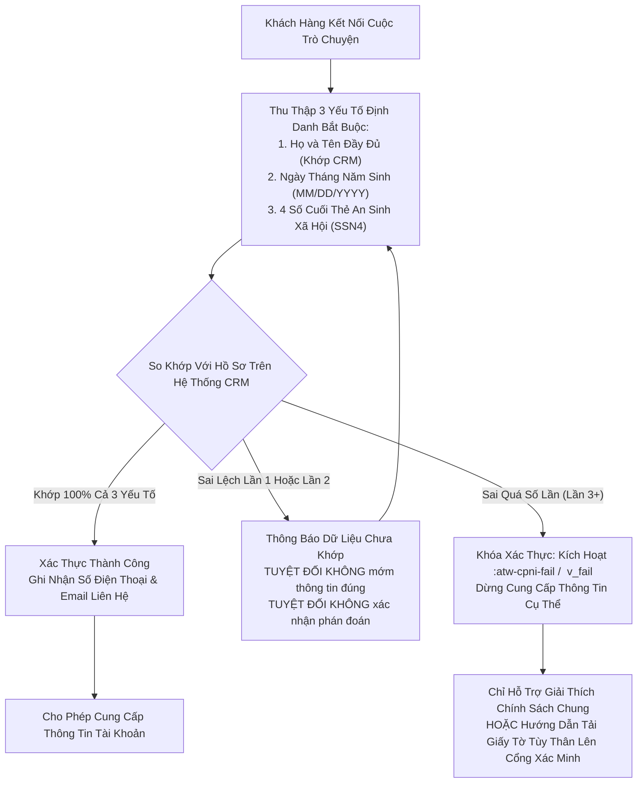
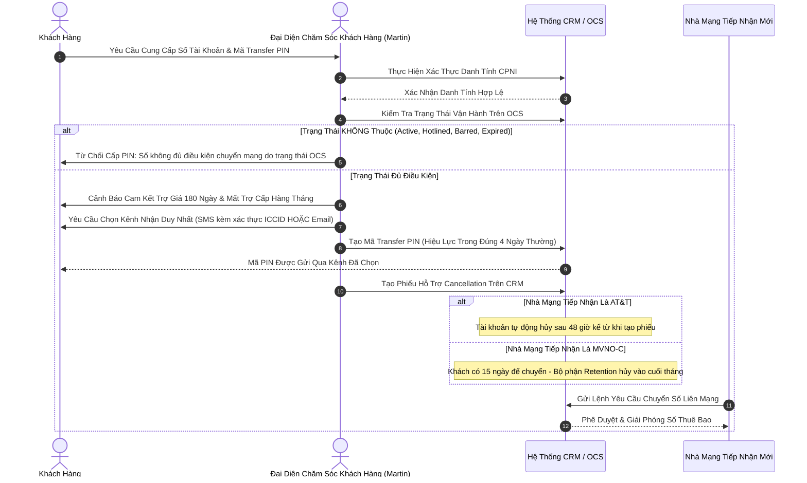
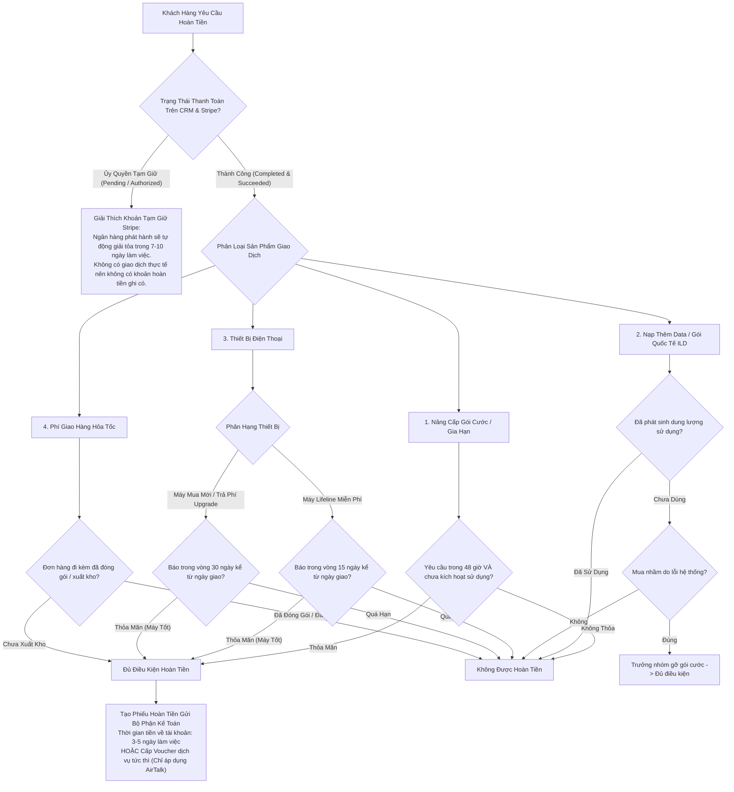
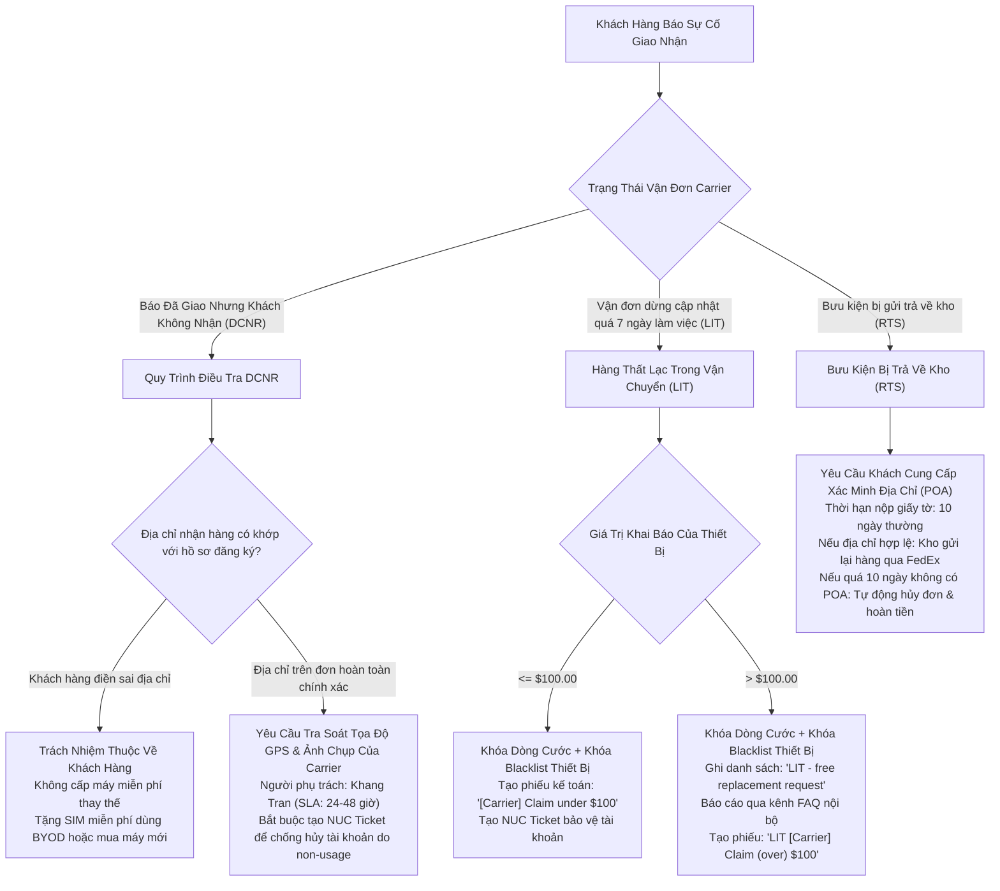
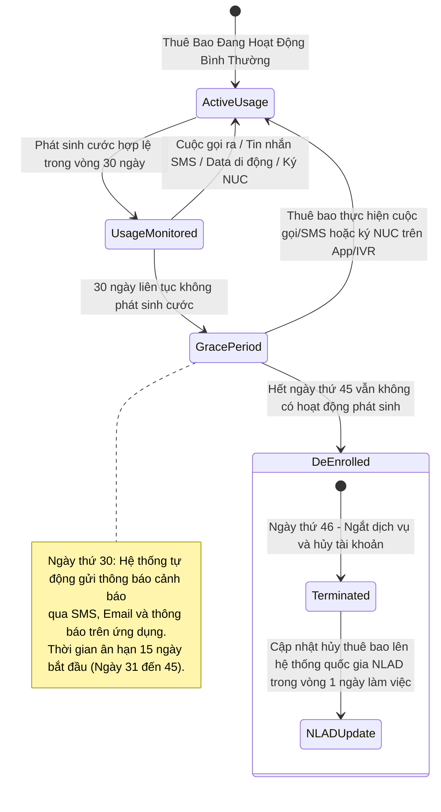
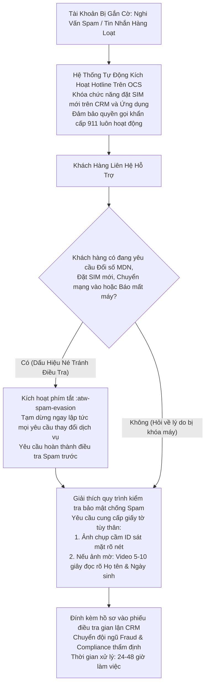

# Softel Solutions - Hệ Thống Vận Hành Hỗ Trợ Khách Hàng & Gõ Tắt Tự Động
**AirTalk Wireless & TAG Mobile - Vận Hành Chương Trình Lifeline & ACP**

---

## 1. Tổng Quan Hệ Thống & Bối Cảnh Vận Hành

Kho lưu trữ này chứa toàn bộ tệp tin cấu hình, ma trận nghiệp vụ đối soát và công cụ tự động hóa dành cho Đại diện Chăm sóc Khách hàng (CSR) và Chat Agent Bậc 1 (Tier 1) tại Softel Solutions. Hệ thống phục vụ hai nhà mạng viễn thông được cấp phép (ETC - Eligible Telecommunications Carrier): **AirTalk Wireless** và **TAG Mobile**.

Vận hành trong lĩnh vực viễn thông trợ cấp liên bang đòi hỏi sự tuân thủ nghiêm ngặt các quy định pháp lý của Ủy ban Truyền thông Liên bang (FCC) và Cơ quan Dịch vụ Phổ cập Viễn thông (USAC). Các CSR phải xử lý đồng thời nhiều phiên tương tác trực tuyến (LiveChat, cổng CRM nội bộ, hàng đợi xử lý sự cố) dưới các tiêu chuẩn kiểm toán Chất lượng (QA) khắt khe.

### 1.1 Mục Tiêu Cốt Lõi
- **Triệt Tiêu 100% Lỗi Chí Mạng (Zero Fatal QA Errors):** Chuẩn hóa toàn bộ câu phản hồi chứa đầy đủ các điều khoản bắt buộc, cam kết thời gian xử lý (SLA) chính xác và bảo vệ nghiêm ngặt Thông tin Mạng Độc quyền của Khách hàng (CPNI).
- **Giải Phóng Dung Lượng Não Bộ (Cognitive Load Reduction):** Loại bỏ việc phải ghi nhớ thủ công hàng trăm con số chính sách phức tạp từ hơn 57 Quy trình Vận hành Tiêu chuẩn (SOP).
- **Thấu Cảm Chuẩn Mực & Xoa Dịu Căng Thẳng (De-escalation):** Đảm bảo mọi phản hồi đều mở đầu bằng sự đồng cảm chân thành với khó khăn của khách hàng trước khi đưa ra khung chính sách hoặc giải pháp kỹ thuật.
- **Tự Động Hóa Biến Số Động (Dynamic Field Injection):** Sử dụng các biểu mẫu tương tác động (`ticket_id`, `port_out_pin`, `puk`) thay thế cho các ký tự giữ chỗ thô cứng, triệt tiêu nguy cơ sót dấu ngoặc vuông khi gửi khách hàng.

---

## 2. Kiến Trúc Cốt Lõi: Mô Hình Modular 3 Vùng (The 3-Zone Architecture)

Toàn bộ kịch bản phản hồi khách hàng được chia thành 3 lớp độc lập. Kiến trúc này cho phép nhân sự sử dụng từng khối đơn lẻ hoặc ghép linh hoạt thành câu trả lời hoàn chỉnh tùy theo trạng thái tâm lý của khách hàng và tiến trình hội thoại:

```
+-----------------------------------------------------------------------------------+
|                            KIẾN TRÚC MODULAR 3 VÙNG                                |
+-----------------------------------------------------------------------------------+
|  [VÙNG ĐỎ - RED LAYER: Thấu Cảm & Xoa Dịu Cảm Xúc]                                |
|  - Ghi nhận và đồng cảm với sự thất vọng, gián đoạn dịch vụ hoặc sự cố vận chuyển |
|  - Tuyệt đối không giải thích quy định hoặc biện hộ kỹ thuật ở lớp này            |
+-----------------------------------------------------------------------------------+
                                          |
                                          v
+-----------------------------------------------------------------------------------+
|  [VÙNG VÀNG - YELLOW LAYER: Giới Hạn Pháp Lý & Quy Định Vận Hành]                 |
|  - Trình bày rõ quy định FCC/USAC, điều khoản công ty và giới hạn kỹ thuật         |
|  - Cung cấp các mốc thời gian chuẩn xác (15 ngày/30 ngày/48 giờ/180 ngày)         |
+-----------------------------------------------------------------------------------+
                                          |
                                          v
+-----------------------------------------------------------------------------------+
|  [VÙNG XANH - GREEN LAYER: Giải Pháp Hành Động & Cam Kết Thời Gian (SLA)]         |
|  - Hướng dẫn các bước khắc phục sự cố hoặc tạo phiếu hỗ trợ (Ticket CRM)          |
|  - Đưa ra mốc thời gian cam kết theo dõi rõ ràng (24 đến 48 giờ làm việc)         |
+-----------------------------------------------------------------------------------+
```

---

## 3. Cấu Trúc Thư Mục Repository

```
e:\softel_vi\
├── .gitignore                          # Bỏ qua các file nhị phân nội bộ PDF/DOCX
├── README.md                           # Tài liệu tổng quan hệ thống và hướng dẫn vận hành tiếng Việt
├── unikey_macro.txt                    # Tệp định nghĩa 174 macro gõ tắt cho Unikey / EVKey
│
├── cheatsheet/                         # Hệ thống tài liệu nghiệp vụ chi tiết
│   ├── MASTER_POLICY_MATRIX.md         # Bảng ma trận đối soát quy định 8 phân hệ cốt lõi
│   ├── SOFTEL_INTERNAL_SOP_DEEP_DIVE.md# Phân tích chuyên sâu 10 phân hệ nghiệp vụ từ 57 SOP gốc
│   ├── QA_SURVIVAL_PLAYBOOK.md         # Cẩm nang kiểm toán QA, thang điểm 100 và xử lý vi phạm
│   ├── RAPID_LOOKUP_CTRL_F.md          # Quy trình phân loại 3 bước và từ điển tra cứu nhanh
│   └── CONCURRENCY_WORKFLOW.md         # Quy chuẩn kỹ thuật xử lý đa nhiệm 3-5 chat song song
│
├── espanso/                            # Bộ cấu hình công cụ gõ tắt Espanso
│   ├── config/
│   │   └── default.yml                 # Cài đặt toàn cục (công cụ clipboard, phím nóng)
│   └── match/
│       ├── airtalk_tag_master.yml      # 62 phím tắt Master :atw- tích hợp biểu mẫu động
│       ├── base_system.yml             # Lời chào, thông báo giữ máy, giữ chuẩn mực giao tiếp (;)
│       ├── verification_cpni.yml       # Xác thực danh tính CPNI, xử lý sai lệch, thu thập ID (;)
│       ├── red_empathy.yml             # Các mô-đun Vùng Đỏ thể hiện sự thấu cảm theo từng sự cố (;)
│       ├── yellow_policy.yml           # Các mô-đun Vùng Vàng giải thích điều khoản và chính sách (;)
│       ├── green_solution.yml          # Các mô-đun Vùng Xanh xử lý kỹ thuật và cam kết SLA (;)
│       └── combos_speed.yml            # Các khối Lego 3 vùng lắp ghép sẵn cho tình huống khẩn (;)
│
└── scripts/                            # Các công cụ kiểm tra tự động và đồng bộ cấu hình
    ├── validate_snippets.py            # Kiểm tra cú pháp YAML, xung đột từ khóa và tính toàn vẹn
    ├── export_unikey.py                # Tự động xuất unikey_macro.txt từ các file YAML
    └── sync_espanso.py                 # Đồng bộ cấu hình vào %APPDATA%\espanso của Windows
```

---

## 4. Sơ Đồ Quy Trình Vận Hành Cốt Lõi

### 4.1 Quy Trình Xác Thực CPNI & Bảo Vệ Tài Khoản
Theo quy định pháp luật liên bang (47 U.S.C. § 222), CSR bắt buộc phải xác thực danh tính khách hàng trước khi cung cấp thông tin tài khoản hoặc thực hiện thay đổi dịch vụ.



---

### 4.2 Vòng Đời Yêu Cầu Chuyển Mạng Giữ Số (Port-Out)
Quy trình thẩm định và phát hành mã chuyển mạng theo SOP_Port-Out V2.1.



---

### 4.3 Cây Quyết Định Thẩm Định Điều Kiện Hoàn Tiền
Hệ thống phân luồng thẩm định hoàn tiền cho 7 nhóm sản phẩm theo SOP_Refund V3.1.



---

### 4.4 Quy Trình Xử Lý Sự Cố Vận Chuyển Logistics (DCNR, LIT, RTS)
Quy trình tiếp nhận và giải quyết khiếu nại giao nhận theo DCNR V3.1 và LIT V2.1.



---

### 4.5 Chu Kỳ 45 Ngày Non-Usage Theo Quy Định FCC / USAC Lifeline
Quy trình tuân thủ quy định sử dụng dịch vụ định kỳ theo Non-Usage Guideline V1.1.



---

### 4.6 Quy Trình Điều Tra Spam & Phòng Thủ Chống Né Tránh
Quy trình đóng băng và xác minh tài khoản bị gắn cờ Spam theo SOP_Spam Handling V2.2.



---

## 5. Bảng Tham Chiếu Phím Tắt Espanso Master (:atw-)

Hệ thống cung cấp 62 phím tắt Master bắt đầu bằng tiền tố `:atw-`, tự động tích hợp biểu mẫu điền thông tin động:

| Tiền Tố Lệnh | Nhóm Nghiệp Vụ Vận Hành | Chức Năng Cốt Lõi | Các Biến Số Động Tự Động Điền |
| :--- | :--- | :--- | :--- |
| `:atw-hi` | Lời Chào Hệ Thống | Lời chào chuẩn mực của CSR Martin, giới thiệu đại diện AirTalk / TAG Mobile. | `Không có` |
| `:atw-cpni-ask` | Xác Thực Danh Tính | Yêu cầu cung cấp 3 thông tin định danh CPNI theo luật liên bang (Họ tên, DOB, SSN4). | `Không có` |
| `:atw-cpni-pass` | Xác Thực Danh Tính | Thông báo xác thực thành công và sẵn sàng hỗ trợ nghiệp vụ cụ thể. | `Không có` |
| `:atw-cpni-fail` | Xác Thực Danh Tính | Thông báo thông tin không khớp; dừng hỗ trợ cụ thể, hướng dẫn tải ID. | `Không có` |
| `:atw-po-combo` | Chuyển Mạng (Port-Out) | Cấp mã Transfer PIN (hiệu lực 4 ngày), cảnh báo ràng buộc trợ giá 180 ngày. | `[[port_out_pin]]`, `[[account_number]]` |
| `:atw-po-cancel` | Hủy Chuyển Mạng | Xác nhận hủy mã Transfer PIN, khôi phục trạng thái hoạt động của thuê bao. | `Không có` |
| `:atw-dcnr-combo` | Sự Cố Logistics | Tiếp nhận khiếu nại đơn hàng báo Delivered nhưng không nhận được máy (SLA 24-48h). | `[[ticket_id]]` |
| `:atw-lit-combo` | Sự Cố Logistics | Tiếp nhận đơn hàng thất lạc trong vận chuyển quá 7 ngày làm việc. | `[[ticket_id]]` |
| `:atw-rts-combo` | Sự Cố Logistics | Hướng dẫn xử lý kiện hàng bị trả về kho và yêu cầu nộp xác minh địa chỉ (POA). | `[[ticket_id]]` |
| `:atw-rush-combo` | Ưu Tiên Xuất Hàng | Cam kết tạo phiếu Hot Rush xuất kho ưu tiên trong 24-48 giờ cho đơn hàng hợp lệ. | `[[ticket_id]]` |
| `:atw-oos-combo` | Hết Hàng Trong Kho | Xin lỗi sự cố hết hàng, đề xuất đổi sang mẫu tương đương hoặc gửi link chọn lại. | `[[order_id]]`, `[[suggested_model]]` |
| `:atw-refund-combo` | Hoàn Tiền | Thông báo chính sách hoàn tiền thiết bị (15 ngày pre-owned, 30 ngày máy mua mới). | `[[ticket_id]]` |
| `:atw-war-ylw` | Bảo Hành Thiết Bị | Giải thích khung thời gian bảo hành (15 ngày máy cũ, 30 ngày máy mới, 48 giờ lỗi vỡ). | `Không có` |
| `:atw-rma-label` | Đổi Trả Thiết Bị | Cung cấp mã vận đơn trả hàng và nhắc nhở mốc gửi bưu điện trong 7 ngày làm việc. | `[[rma_number]]`, `[[tracking_number]]` |
| `:atw-stolen-combo` | Báo Mất / Trộm Cắp | Xác nhận khóa đường truyền ngay lập tức và đưa IMEI vào danh sách chặn Blacklist. | `[[imei]]` |
| `:atw-mdn-combo` | Đổi Số Điện Thoại | Hướng dẫn quy trình đổi số điện thoại với mức phí quy định $25.00. | `[[new_mdn]]` |
| `:atw-puk-combo` | Mở Khóa Thẻ SIM | Cấp mã PUK1 giải cứu SIM bị khóa và cảnh báo nhập sai 10 lần sẽ hỏng chip. | `[[puk_code]]` |
| `:atw-esim-combo` | Cài Đặt eSIM | Hướng dẫn tải và cài đặt hồ sơ eSIM qua mã QR với yêu cầu bắt buộc có Wi-Fi. | `Không có` |
| `:atw-vm-combo` | Hộp Thư Thoại | Hướng dẫn cài đặt hộp thư thoại, đặt lại mật khẩu về 4 số cuối của số điện thoại. | `[[default_pin]]` |
| `:atw-nonuse-ylw` | Tuân Thủ Lifeline | Giải thích quy tắc 30 ngày không sử dụng + 15 ngày ân hạn (tổng 45 ngày). | `Không có` |
| `:atw-recert-combo` | Tái Xác Thực Năm | Hướng dẫn khách hàng bị de-enroll do trượt recertify kết nối lại bằng link cá nhân. | `[[reapply_link]]` |
| `:atw-spam-evasion` | Chống Gian Lận | Chặn hành vi né tránh điều tra Spam (đòi đổi số, đòi mua SIM mới khi đang bị khóa). | `Không có` |
| `:atw-slam-combo` | Bảo Vệ Trợ Cấp | Hướng dẫn lấy lại quyền lợi Lifeline khi bị đại lý ngoài đánh cắp trái phép. | `Không có` |
| `:atw-hold-check` | Giữ Máy Kiểm Tra | Cập nhật định kỳ 45 giây một lần để làm mới đồng hồ thời gian phản hồi (ART). | `Không có` |
| `:atw-warn-profanity`| Giữ Gìn Chuẩn Mực | Cảnh báo lịch sự lần 1 khi khách hàng có lời lẽ khiếm nhã hoặc xúc phạm. | `Không có` |
| `:atw-disconnect` | Kết Thúc Vi Phạm | Thông báo ngắt phiên trò chuyện sau khi đã cảnh báo mà khách vẫn tiếp tục thô lỗ. | `Không có` |
| `:atw-crm-note` | Ghi Chú Hồ Sơ | Biểu mẫu chuẩn mực ghi chú hoạt động trên hệ thống CRM sau khi kết thúc phiên. | `[[contact_reason]]`, `[[action_taken]]` |

---

## 6. Tiêu Chuẩn Kiểm Toán Điểm Chất Lượng (QA Compliance Scoring)

| Hạng Mục Kiểm Toán | Tỷ Trọng | Lỗi Chí Mạng (Fatal Errors - Điểm 0 Tức Thì) | Biện Pháp Phòng Thủ Bằng Phím Tắt |
| :--- | :---: | :--- | :--- |
| **1. Xác Thực Danh Tính CPNI** | **30% (Chí Mạng)** | • Tiết lộ thông tin tài khoản khi chưa xác thực đủ Họ tên, DOB, SSN4.<br>• Mớm dữ liệu đúng khi khách đoán sai.<br>• Cấp mã Port-Out PIN hoặc gửi máy mới khi chưa pass CPNI. | Sử dụng `:atw-cpni-ask` ngay từ tin nhắn thứ 2; kích hoạt `:atw-cpni-fail` khi sai lệch thông tin. |
| **2. Cam Kết SLA & Chính Sách** | **25% (Chí Mạng)** | • Báo sai thời hạn bảo hành hoặc đổi trả (báo 7 ngày cào bằng).<br>• Hứa hoàn tiền cước tháng viễn thông hoặc data đã dùng.<br>• Báo sai thời hạn mã PIN chuyển mạng (nói 30 ngày thay vì 4 ngày).<br>• Bỏ sót mốc 48 giờ báo nứt vỡ màn hình/ngoại quan. | Luôn dùng các mô-đun Vùng Vàng đã kiểm toán: `:atw-war-ylw`, `:atw-refund-ylw`, `:atw-po-ylw`, `:atw-nonuse-ylw`. |
| **3. Chuẩn Mực Giao Tiếp & Tôn Trọng** | **20% (Chí Mạng)** | • Tự ý ngắt chat khi khách đang nói mà chưa qua 2 bước cảnh báo.<br>• Dùng từ ngữ tranh cãi, mỉa mai, công kích khách hàng.<br>• Hoàn toàn phớt lờ cảm xúc tiêu cực của khách. | Mở đầu bằng Vùng Đỏ `:atw-deescalate`; áp dụng quy trình cảnh báo 2 bước: `:atw-warn-profanity` rồi mới đến `:atw-disconnect`. |
| **4. Tốc Độ Phản Hồi (FRT / ART)** | **15%** | • Để khoảng im lặng quá 90 giây không có tin nhắn tương tác.<br>• Lần phản hồi đầu tiên (FRT) vượt quá 60 giây. | Gõ `:atw-hold-check` hoặc `;h_check` mỗi 45 giây để làm mới đồng hồ hệ thống. |
| **5. Kết Thúc & Ghi Chú Hồ Sơ** | **10%** | • Không hỏi câu xác nhận kết thúc chuẩn mực.<br>• Bỏ trống Activity Note trên CRM hoặc phân loại sai loại Ticket. | Gõ câu chốt `:atw-wrapup` và chèn sẵn khung ghi chú hồ sơ `:atw-crm-note`. |

---

## 7. Hướng Dẫn Cài Đặt & Sử Dụng

### 7.1 Cài Đặt Bộ Gõ Tắt Espanso (Khuyên Dùng)
1. Tải và cài đặt phần mềm mã nguồn mở Espanso:
   ```powershell
   winget install Espanso.Espanso -e
   ```
2. Đồng bộ các tệp cấu hình từ dự án vào máy tính cá nhân:
   ```powershell
   python scripts/sync_espanso.py
   ```
3. Khởi chạy ứng dụng Espanso:
   ```powershell
   Start-Process "$env:LOCALAPPDATA\Programs\Espanso\espansod.exe" -ArgumentList "launcher"
   ```

### 7.2 Sử Dụng Qua Unikey / EVKey Macro
Nếu môi trường làm việc không cho phép cài đặt phần mềm bên ngoài, CSR có thể sử dụng trực tiếp tệp macro Unikey:
1. Mở bảng điều khiển Unikey hoặc EVKey trên máy tính.
2. Bật tính năng **Bật tính năng gõ tắt (Enable Macro)**.
3. Nhấp vào **Bảng gõ tắt... (Macro Table)** và chọn nạp tệp [`unikey_macro.txt`](file:///e:/softel_vi/unikey_macro.txt).
4. Sử dụng hệ thống phím tắt nhanh bắt đầu bằng dấu chấm phẩy (ví dụ: `;hi`, `;v_cpni`, `;c_po`, `;h_check`).
