# QUY CHUẨN KỸ THUẬT QUẢN LÝ ĐA NHIỆM (CONCURRENCY CHAT WORKFLOW)
**Kiến Trúc Vận Hành Lưu Lượng Cao & Phân Tách Ngữ Cảnh Chống Rò Rỉ Dữ Liệu**
*Mã tài liệu: OPS-STD-CNC-2026-V2 | Phân loại: Tiêu chuẩn Vận hành Kỹ thuật*
*Vị trí áp dụng: Đại diện Chăm sóc Khách hàng Bậc 1 (CSR: Martin)*

---

## 1. Nguyên Tắc Kỹ Thuật Đa Nhiệm Trong Viễn Thông Liên Bang

Đại diện Chăm sóc Khách hàng Bậc 1 (CSR) tại Softel Solutions làm việc trong môi trường đa luồng với mật độ tương tác cao. Mỗi nhân sự phải chịu trách nhiệm xử lý đồng thời từ **3 đến 5 phiên chat song song** trên các nền tảng cổng LiveChat và hệ thống quản trị CRM nội bộ, trong khi vẫn phải tuân thủ tuyệt đối các quy định bảo mật Thông tin Mạng Độc quyền của Khách hàng (CPNI) theo luật pháp Hoa Kỳ.

### 1.1 Bẫy Quá Tải Khi Thao Tác Thủ Công
Việc gõ phím thủ công và nhớ chính sách rời rạc khi trực đa nhiệm dẫn đến các rủi ro nghiêm trọng:
1. **Rò Rỉ Dữ Liệu CPNI Chéo Giữa Các Khách Hàng:** Vô tình gửi nhầm mã Transfer PIN hoặc mã PUK của Khách hàng A sang cửa sổ chat của Khách hàng B — đây là lỗi vi phạm bảo mật liên bang cấp độ cao nhất dẫn đến việc nhân viên bị sa thải và công ty chịu phạt kiểm toán.
2. **Trễ Thời Gian Phản Hồi (Vượt Ngưỡng ART 90 Giây):** Việc để khoảng im lặng quá dài khiến hệ thống LiveChat tính điểm phạt tốc độ và khách hàng nảy sinh tâm lý bỏ rơi, dẫn đến khiếu nại gay gắt.
3. **Quá Tải Tâm Lý & Sai Lệch Chính Sách:** Việc cố gắng ghi nhớ hàng trăm thông số dễ gây nhầm lẫn (ví dụ: nhầm cam kết trợ giá thiết bị 180 ngày thành quy tắc 365 ngày nhận máy miễn phí).

### 1.2 Bảng Chỉ Số Hiệu Suất Vận Hành Chuẩn (KPIs)

| Chỉ Số Đo Lường Hiệu Năng | Định Nghĩa Kỹ Thuật Vận Hành | Ngưỡng Mục Tiêu | Ngưỡng Bị Tính Lỗi Kiểm Toán |
| :--- | :--- | :--- | :--- |
| **Thời Gian Phản Hồi Đầu Tiên (FRT)** | Khoảng thời gian từ khi chat vào hàng đợi đến khi CSR gửi lời chào đầu tiên. | **<= 20 Giây** | > 60 Giây |
| **Thời Gian Phản Hồi Trung Bình (ART)** | Khoảng thời gian trung bình giữa tin nhắn của khách và phản hồi của CSR. | **<= 45 Giây** | > 90 Giây |
| **Thời Gian Xử Lý Cuộc Gọi (AHT)** | Tổng thời lượng phiên tương tác từ lúc nhận đến khi hoàn tất ghi chú CRM. | **8 đến 12 Phút** | > 18 Phút (Không báo cáo) |
| **Tỷ Lệ Rò Rỉ Dữ Liệu CPNI Chéo** | Tỷ lệ gửi nhầm thông tin thuê bao này sang cho thuê bao khác. | **0.00% (Không Khoan Nhượng)** | 1 vụ việc = Trượt kiểm toán |

---

## 2. Kiến Trúc Băng Chuyền Đa Phiên: Cơ Chế Xử Lý 3 Giai Đoạn

Nhằm giải phóng tốc độ gõ phím khỏi độ trễ vận hành, toàn bộ các phiên trò chuyện đồng thời được chuẩn hóa vào 3 trạng thái của một băng chuyền khép kín:

```mermaid
stateDiagram-v2
    [*] --> InboundStage: Phiên Chat Mới Được Phân Phối Vào Hàng Đợi
    
    state InboundStage {
        [*] --> IngestSession: Nhận Phiên Chat (< 10s)
        IngestSession --> DeployGreeting: Gõ Lời Chào :atw-hi (< 5s)
        DeployGreeting --> DeployCPNI: Gõ Câu Hỏi CPNI :atw-cpni-ask (< 5s)
        DeployCPNI --> QueueWait: Chờ Khách Cung Cấp Thông Tin Định Danh
    }
    
    InboundStage --> InvestigationStage: Nhận Đủ 3 Thông Tin Định Danh
    
    state InvestigationStage {
        [*] --> PinCRM: Mở & Ghim Hồ Sơ CRM Theo MDN/EID
        PinCRM --> VerifyTokens: Đối Soát Khớp 100% Cả 3 Yếu Tố
        VerifyTokens --> DatabaseLookup: Tra Cứu Hệ Thống OCS / Vận Đơn Carrier
        DatabaseLookup --> HeartbeatLoop: Nếu tra cứu > 45s -> Gõ :atw-hold-check
        HeartbeatLoop --> DatabaseLookup
    }
    
    InvestigationStage --> ResolutionStage: Xác Định Được Nguyên Nhân & Hướng Xử Lý
    
    state ResolutionStage {
        [*] --> AssembleLego: Gõ Phím Tắt Modular 3 Vùng (Hoặc Combo)
        AssembleLego --> CustomerConfirmation: Khách Hàng Đồng Ý Với Phương Án
        CustomerConfirmation --> StandardWrapUp: Gõ Lời Chốt :atw-wrapup & :atw-bye
        StandardWrapUp --> CRMDisposition: Chèn :atw-crm-note & Đóng Hồ Sơ Hoàn Tất
    }
    
    ResolutionStage --> [*]: Kết Thúc Phiên Làm Việc Sạch Sẽ
```

---

## 3. Đặc Tả Thao Tác Chi Tiết Theo Từng Giai Đoạn

### 3.1 Giai Đoạn 1: Tiếp Nhận Đầu Vào (Thời Gian: 0 Đến 30 Giây)
- **Mục tiêu cốt lõi:** Bảo vệ chỉ số FRT (< 20 giây) và kích hoạt quy trình xác thực CPNI mà không cần suy nghĩ câu chữ.
- **Quy trình thao tác:**
  1. Nhấp nhận phiên chat ngay khi có tín hiệu âm thanh hoặc hình ảnh.
  2. Gõ ngay lời chào và câu hỏi xác thực đa yếu tố CPNI bằng phím tắt mở rộng:
     - Thao tác: Gõ `:atw-hi` sau đó gõ `:atw-cpni-ask` (hoặc cú pháp nhanh `;hi` + `;v_cpni`).
  3. Tổng thời gian gõ phím không được vượt quá **3 giây**.
  4. Chuyển ngay tiêu điểm cửa sổ sang phiên chat tiếp theo. Không dừng lại nhìn con trỏ nhấp nháy chờ khách trả lời.

### 3.2 Giai Đoạn 2: Tra Cứu Hệ Thống & Giữ Nhịp Hội Thoại (Thời Gian: 30 Đến 180 Giây)
- **Mục tiêu cốt lõi:** Hoàn tất tra cứu trên các cổng dữ liệu CRM, OCS và hãng vận chuyển, đồng thời liên tục làm mới đồng hồ ART của hệ thống.
- **Quy trình thao tác:**
  1. Khi khách cung cấp thông tin định danh, chuyển đến cửa sổ CRM tương ứng.
  2. Đối chiếu chuẩn xác 3 yếu tố: Họ tên, Ngày sinh DOB, 4 số cuối SSN.
  3. Nếu quá trình tra cứu hoặc kiểm tra kỹ thuật kéo dài hơn 45 giây:
     - Gõ ngay phím tắt giữ máy: `:atw-hold-check` (hoặc `;h_check`).
     - Nội dung bung ra: *"I am currently reviewing your account details in our system. Please bear with me for about 1 to 2 minutes, and I will be right back with an update!"*
  4. Tin nhắn này lập tức đưa đồng hồ ART của phiên chat về mốc 0 giây và trấn an khách hàng không bị cảm giác bỏ rơi.

### 3.3 Giai Đoạn 3: Lắp Ghép Giải Pháp & Chốt Ca (Thời Gian: 180+ Giây)
- **Mục tiêu cốt lõi:** Đưa ra giải pháp đúng quy định, kiểm tra mức độ hài lòng của khách hàng và lưu trữ hồ sơ kiểm toán đầy đủ.
- **Quy trình thao tác:**
  1. Sử dụng các phím tắt Lego 3 Vùng hoặc các phím tắt combo lắp ghép sẵn (ví dụ: `:atw-po-combo`, `:atw-rush-combo`):
     - `[VÙNG ĐỎ Thấu Cảm]` -> `[VÙNG VÀNG Chính Sách]` -> `[VÙNG XANH Giải Pháp]`
  2. Xác nhận mức độ hài lòng trước khi đóng:
     - Thao tác: Gõ `:atw-wrapup` (hoặc `;wrapup`).
  3. Khi khách chào kết thúc, gửi lời chào chuẩn mực:
     - Thao tác: Gõ `:atw-bye` (hoặc `;bye`).
  4. Cập nhật ngay nhật ký hoạt động trên CRM:
     - Thao tác: Gõ `:atw-crm-note` (hoặc `;crm_note`). Điền lý do liên hệ, giải pháp đã xử lý và mã phiếu hỗ trợ.

---

## 4. Kỹ Thuật Phân Tách Ngữ Cảnh & Phòng Chống Rò Rỉ Dữ Liệu Chéo

Khi xử lý đồng thời tới 5 phiên chat, nguy cơ nhầm lẫn dữ liệu giữa các khách hàng là rủi ro sống còn. CSR Martin bắt buộc phải thực thi các nguyên tắc phân tách:

### 4.1 Quy Tắc Ghim Tab CRM Riêng Biệt (1 Tab = 1 Khách Hàng)
- Mỗi cửa sổ chat đang mở bắt buộc phải tương ứng với **đúng một tab trình duyệt CRM ghim sẵn hồ sơ của thuê bao đó**.
- Tuyệt đối không dùng chung một tab CRM để liên tục tìm kiếm và chuyển đổi giữa nhiều khách hàng khác nhau trong cùng một thời điểm.
- Thứ tự sắp xếp các tab CRM trên thanh trình duyệt phải đồng bộ theo đúng thứ tự từ trái qua phải của các cửa sổ chat đang mở.

### 4.2 Nguyên Tắc "Nhìn Lại Hai Lần" Trước Khi Bấm Gửi
Trước khi bấm phím `Enter` hoặc nhấp nút `Send` cho bất kỳ tin nhắn nào có chứa dữ liệu nhạy cảm (Mã Transfer PIN, Mã PUK, Mã vận đơn, Số điện thoại):
1. **Lần nhìn 1:** Nhìn vào dòng tên khách hàng trên thanh tiêu đề của cửa sổ chat.
2. **Lần nhìn 2:** Nhìn vào dòng tên khách hàng trên tiêu đề hồ sơ CRM đang mở.
3. Chỉ khi hai chuỗi ký tự họ tên này khớp nhau 100%, CSR mới được phép bấm gửi tin nhắn.

### 4.3 Vệ Sinh Bộ Nhớ Tạm (Clipboard Sanitization)
- **Nghiêm cấm:** CSR không được phép sao chép các thông tin định danh cá nhân nhạy cảm hoặc mã số bảo mật ra khay nhớ tạm (Clipboard) chung của hệ điều hành.
- **Giải pháp:** Sử dụng tính năng biểu mẫu điền thông tin tương tác của Espanso (`[[port_out_pin]]`, `[[ticket_id]]`, `[[puk]]`). Biểu mẫu sẽ hiển thị ô nhập liệu trực tiếp trên màn hình và tự động lắp ráp vào đoạn văn bản cần gửi, triệt tiêu nguy cơ dán nhầm dữ liệu của khách hàng trước đó.

---

## 5. Lịch Trình Xoay Vòng Cửa Sổ Theo Lát Cắt Thời Gian 15 Giây

Khi quản lý đồng thời 5 phiên chat cùng lúc, CSR áp dụng cơ chế phân chia thời gian luân phiên (Round-Robin Time Slicing). Bảng dưới đây minh họa chu kỳ 90 giây mẫu:

| Lát Cắt (Giây) | Cửa Sổ Thao Tác | Trạng Thái Băng Chuyền | Thao Tác Kỹ Thuật Thực Hiện |
| :--- | :--- | :--- | :--- |
| **00 - 15** | Chat 1 (Khách mới vào) | Giai đoạn 1 (Tiếp nhận) | Gõ `:atw-hi` + `:atw-cpni-ask` (Chuyển chat sang trạng thái chờ) |
| **15 - 30** | Chat 2 (Đang tra cứu) | Giai đoạn 2 (Giữ máy) | Kiểm tra CRM -> Gõ `:atw-hold-check` (Đồng hồ ART về 0) |
| **30 - 45** | Chat 3 (Đang chốt ca) | Giai đoạn 3 (Giải quyết) | Gõ `:atw-po-combo` (Cấp mã PIN) -> Gõ `:atw-wrapup` |
| **45 - 60** | Chat 4 (Đang kiểm tra) | Giai đoạn 2 (Kỹ thuật) | Kiểm tra mạng OCS -> Gõ `:atw-hold-tool` |
| **60 - 75** | Chat 5 (Khách mới vào) | Giai đoạn 1 (Tiếp nhận) | Gõ `:atw-hi` + `:atw-cpni-ask` (Chuyển chat sang trạng thái chờ) |
| **75 - 90** | Chat 1 (Khách đã gửi PII) | Giai đoạn 2 (Xác thực) | Đối chiếu thông tin PII trên CRM -> Gõ `:atw-cpni-pass` |

> [!NOTE]
> Bằng cách chia ca làm việc thành các lát cắt 15 giây luân phiên, không có bất kỳ khách hàng nào phải chờ đợi quá 75 giây mà không có phản hồi, đảm bảo 100% tuân thủ trần giới hạn ART 90 giây của phòng kiểm toán QA.

---

## 6. Xử Lý Các Tình Huống Ngoại Lệ Trong Giờ Cao Điểm

### 6.1 Nhiều Khách Hàng Đổ Vào Cùng Lúc
Khi có từ 3 phiên chat mới trở lên đổ về trong cùng một khoảng thời gian 5 giây:
1. Thao tác ngay phím tắt `:atw-hi` lần lượt qua tất cả các tab mới (mất dưới 6 giây cho cả 3 tab).
2. Quay lại gõ `:atw-cpni-ask` lần lượt qua cả 3 tab.
3. Thao tác này giúp đạt chuẩn chỉ số FRT cho toàn bộ các line cùng lúc và đẩy khoảng thời gian chờ sang phía khách hàng đang gõ thông tin.

### 6.2 Khách Hàng Bức Xúc Chen Ngang Khi Đang Xử Lý Ca Phức Tạp
Nếu một khách hàng có thái độ gay gắt hoặc liên tục nhắn tin hối thúc trong khi CSR đang tập trung tra soát hồ sơ vận chuyển cho một khách hàng khác:
1. Không ngắt quãng suy nghĩ để tự gõ lời giải thích dài dòng.
2. Firing ngay phím tắt Vùng Đỏ `:atw-deescalate` hoặc phím tắt giữ gìn chuẩn mực `:atw-warn-profanity` để hạ nhiệt cảm xúc.
3. Quay lại hoàn tất bước chẩn đoán cho khách hàng trước, sau đó mới quay lại xử lý triệt để ca khiếu nại.
