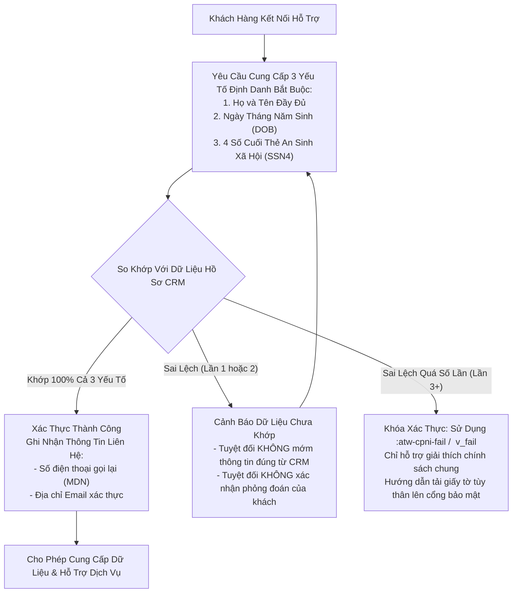
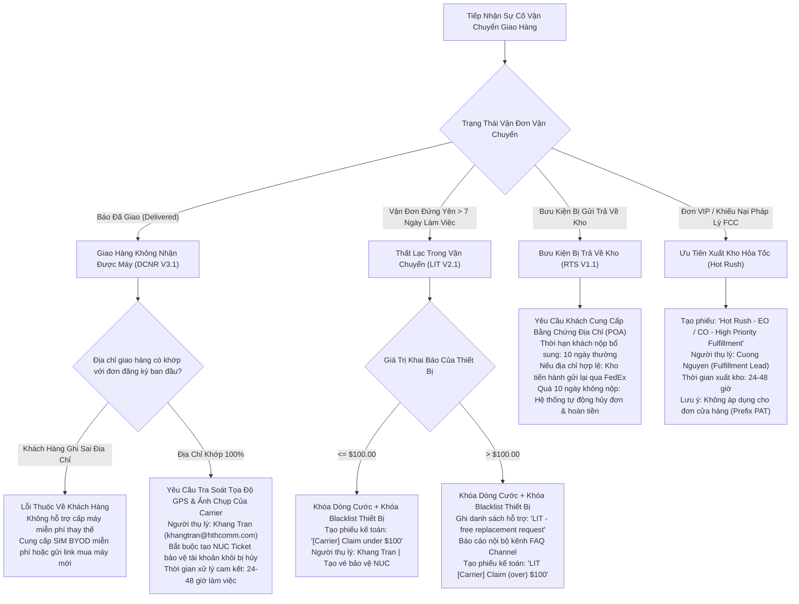
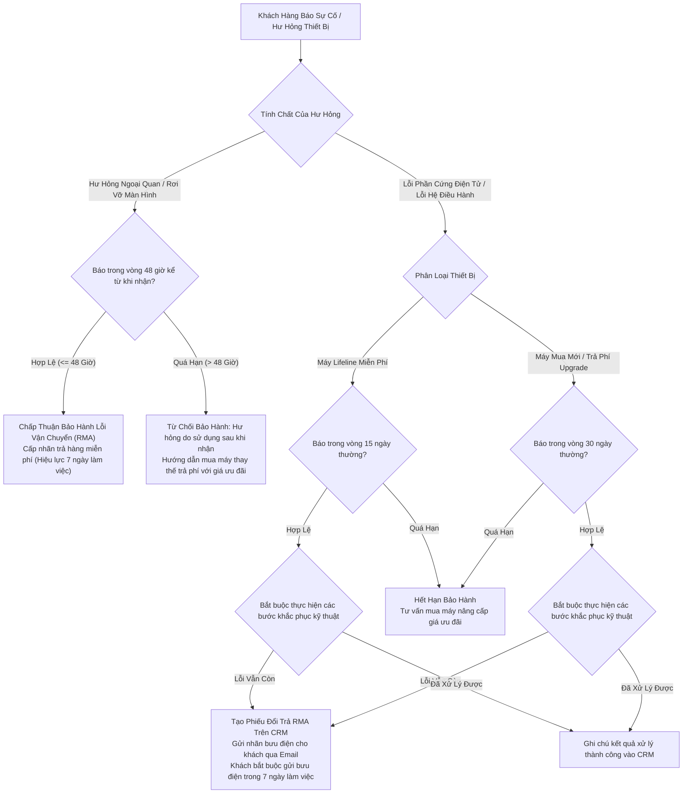
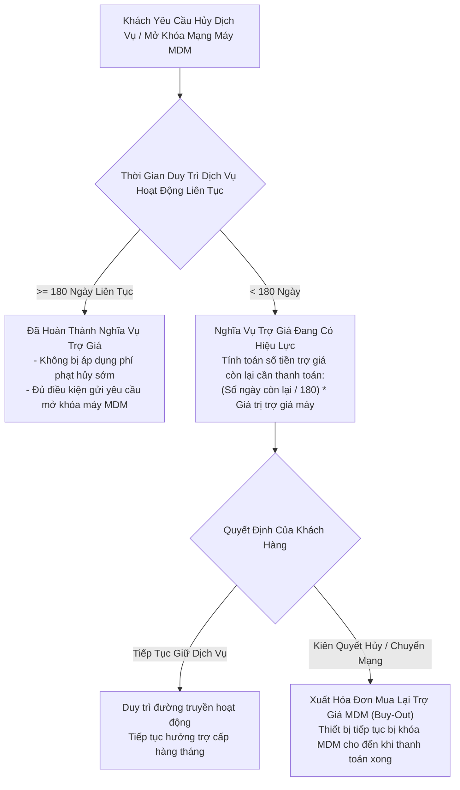
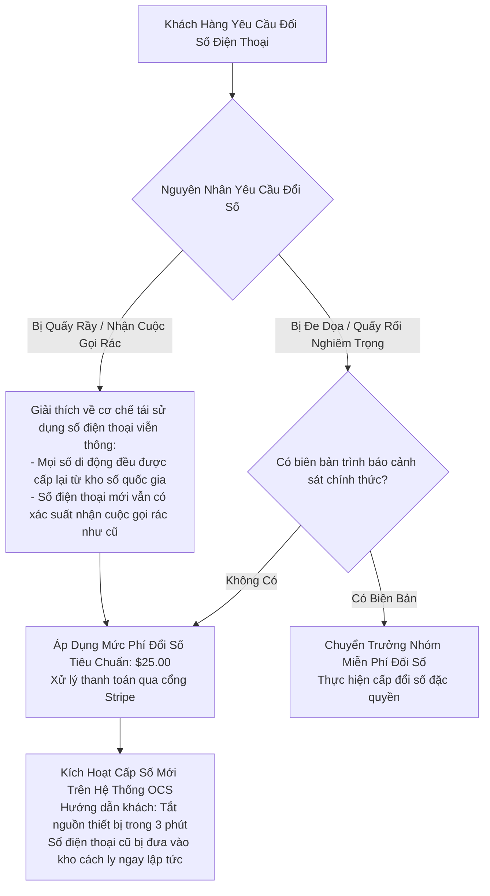
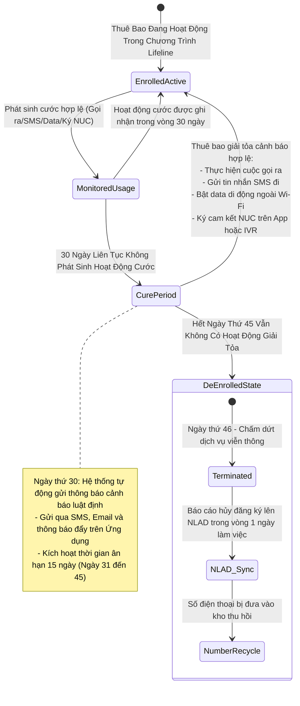
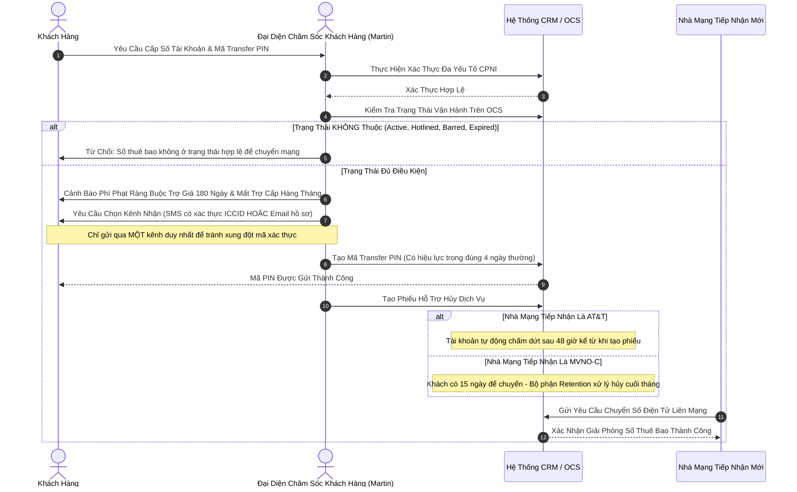
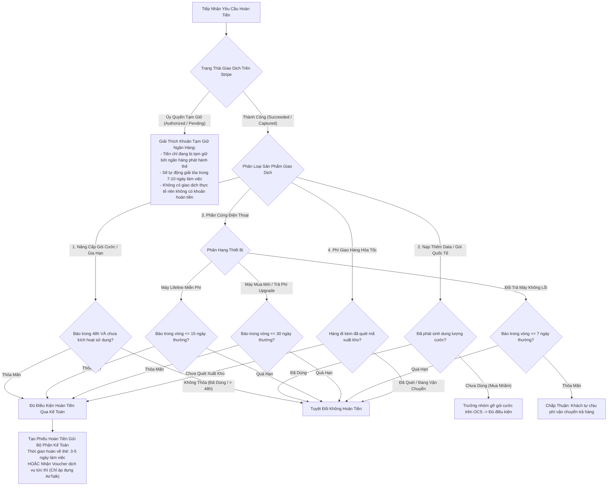

# ĐẶC TẢ QUY TRÌNH VẬN HÀNH TIÊU CHUẨN & MA TRẬN CHÍNH SÁCH
**AirTalk Wireless & TAG Mobile - Vận Hành Hệ Sinh Thái Lifeline, ACP & MVNO**
*Mã tài liệu: SOP-POL-MAT-2026-V4 | Phân loại: Tài liệu Kỹ thuật Vận hành*
*Vị trí áp dụng: Đại diện Chăm sóc Khách hàng Bậc 1 (CSR: Martin)*

---

## 1. Kiểm Soát Tài Liệu & Ma Trận Đối Soát Sai Lệch SLA

Tài liệu này xác lập các thông số vận hành chuẩn mực, quy định pháp lý bắt buộc và cam kết thời gian xử lý (SLA) áp dụng cho mọi tương tác hỗ trợ khách hàng tại Softel Solutions cho hai nhà mạng AirTalk Wireless và TAG Mobile. Mọi thông số tại đây đều được đối chiếu trực tiếp từ các quy định của Ủy ban Truyền thông Liên bang (FCC) và Cơ quan Dịch vụ Phổ cập Viễn thông (USAC).

### 1.1 Bảng Đối Soát Sai Lệch SLA & Phòng Thủ Lỗi Liệt QA

| Nhóm Quy Trình Vận Hành | Thông Số Sai Lệch Thường Gặp (Bẫy Lỗi) | Thông Số Chuẩn Theo SOP Nội Bộ Đã Kiểm Toán | Rủi Ro Pháp Lý & Hậu Quả Kiểm Toán QA |
| :--- | :--- | :--- | :--- |
| **Chính Sách Hoàn Tiền (Refund)** | Áp dụng cào bằng mốc 7 ngày cho mọi loại đơn hàng và thiết bị. | • Máy Lifeline Miễn Phí: Đổi trả/hoàn tiền trong **15 ngày thường** kể từ ngày giao thành công. • Máy Mua Mới & Trả Phí Nâng Cấp: Đổi trả/hoàn tiền trong **30 ngày thường**. • Thiết Bị Không Lỗi (Non-Defective): Đổi trả trong **7 ngày thường** (khách tự chịu phí vận chuyển trả hàng). • Cước Thuê Bao Tháng, Data Top-up & ILD: **Tuyệt đối không hoàn tiền**. | **Lỗi Fatal QA 25% (False Promise):** Báo sai quyền lợi 30 ngày của khách mua máy trả phí vi phạm quyền lợi người tiêu dùng; hứa hoàn tiền cước viễn thông gây thất thoát tài chính. |
| **Bảo Hành Thiết Bị (Warranty)** | Áp dụng khung bảo hành 15 ngày duy nhất cho tất cả các dòng máy. | • Máy Lifeline Miễn Phí & Phụ Kiện: Bảo hành **15 ngày thường** kể từ ngày nhận hàng. • Máy Mua Mới & Trả Phí Upgrade: Bảo hành **30 ngày thường** kể từ ngày nhận hàng. • Hư Hỏng Vật Lý / Màn Hình Vỡ: **Bắt buộc báo trong vòng 48 giờ** từ khi giao. • Nhãn Trả Hàng (RMA Label): Có giá trị trong **7 ngày làm việc** để gửi bưu điện. | **Lỗi Fatal QA / Thất Thoát:** Bỏ sót mốc 48 giờ khiến công ty phải chịu chi phí bảo hành màn hình vỡ do khách làm rơi sau khi nhận; từ chối máy trả phí trong hạn 30 ngày bị phạt FCC. |
| **Cam Kết Trợ Giá (Device Subsidy)** | Báo khách hàng phải duy trì hợp đồng cam kết 365 ngày. | • Cam Kết Trợ Giá Thiết Bị: Đúng **180 ngày hoạt động liên tục**. • Quy Tắc Nhận Máy Miễn Phí: Mỗi hộ gia đình chỉ được nhận 1 máy miễn phí mỗi **365 ngày**. | **Vi Phạm Hợp Đồng:** Nhầm lẫn mốc 180 ngày thành 365 ngày vi phạm quy định minh bạch thông tin cước của FCC, gây hoang mang và khiếu nại leo thang. |
| **Mã Chuyển Mạng (Port-Out PIN)** | Cấp mã Transfer PIN có hạn 30 ngày và thiếu cảnh báo cam kết. | • Thời Hạn Mã Transfer PIN: Đúng **4 ngày thường** (96 giờ). • Cảnh Báo Bắt Buộc: Mất trợ cấp chính phủ hàng tháng và chịu phí phạt nếu chưa hoàn thành **180 ngày cam kết trợ giá**. | **Lỗi Fatal QA 30% (Bảo Mật):** Báo sai thời hạn làm hỏng lệnh chuyển mạng của khách; thiếu cảnh báo làm mất quyền truy thu chi phí thiết bị của công ty. |
| **Không Dùng Dịch Vụ (Non-Usage)** | Báo mốc hủy tài khoản không rõ ràng sau 30 hoặc 60 ngày. | • 30 ngày liên tục không dùng cước -> Phát cảnh báo tự động. • 15 ngày ân hạn (từ ngày 31 đến 45). • Ngày thứ 46: Tự động hủy tài khoản, **cập nhật dữ liệu quốc gia NLAD trong 1 ngày làm việc**. | **FCC 47 CFR § 54.405 / 54.407:** Không tuân thủ dẫn đến việc công ty bị xử phạt kiểm toán liên bang và bị USAC thu hồi ngân sách trợ cấp viễn thông. |

---

## 2. Bảo Vệ Dữ Liệu Khách Hàng (CPNI) & An Ninh Tài Khoản

Theo luật viễn thông liên bang (47 U.S.C. § 222 và FCC 47 CFR §§ 64.2001–64.2011), CSR tuyệt đối không được tiết lộ lịch sử cuộc gọi, cước phí, thông tin thiết bị hoặc thực hiện bất kỳ thay đổi nào trước khi hoàn tất xác thực đa yếu tố Bậc 1.

### 2.1 Sơ Đồ Quy Trình Xác Thực Đa Yếu Tố CPNI

### 2.2 Quy Chuẩn Thao Tác CPNI Nghiêm Ngặt
1. **Tiêu Chuẩn So Khớp Tên:** First Name và Last Name phải khớp chính xác với hồ sơ CRM. Không bắt buộc Middle Name. Bỏ qua các hậu tố (*Jr., Sr., II, III, IV*). Chấp nhận các biến thể có dấu gạch nối (*Smith-Jones*) hoặc dấu nháy (*O'Connor*).
2. **Ngày Sinh (DOB):** Phải khớp 100% theo định dạng chuẩn `MM/DD/YYYY`.
3. **4 Số Cuối SSN:** Phải khớp chính xác với 4 số cuối đã lưu trên hệ thống đồng bộ với cơ sở dữ liệu USAC/NLAD.
4. **An Ninh Lưu Trữ Dữ Liệu:** **Tuyệt đối không đính kèm, dán hoặc tải ảnh giấy tờ tùy thân của khách vào Activity Note trên CRM**. Nhân sự chỉ được ghi lại mã Ticket ID hoặc Chat Session ID chứa dữ liệu đã mã hóa.
5. **Cơ Chế SIM Port-Protection:** Tự động kích hoạt khi khách hoặc nhân viên nhập sai thông tin xác thực quá 3 lần. Khách hàng phải tự đăng nhập cổng điện tử cá nhân (`Account > My SIM > SIM - Port Unlock`) để mở khóa.

---

## 3. Quản Lý Logistics, Giao Nhận & Xử Lý Sự Cố Vận Chuyển

Mọi đơn hàng phần cứng đều được vận chuyển qua các đối tác bưu chính (FedEx, USPS). Khi xảy ra sự cố gián đoạn, CSR phải phân loại và xử lý theo đúng ma trận thẩm định.

### 3.1 Cây Quyết Định Phân Luồng Khiếu Nại Logistics

---

## 4. Vòng Đời Thiết Bị, Quy Định Bảo Hành & Cam Kết Trợ Giá

### 4.1 Quy Trình Đánh Giá Bảo Hành Thiết Bị & Đổi Trả (RMA)

### 4.2 Cam Kết Trợ Giá 180 Ngày & Quy Trình Mua Lại (MDM Buy-Out)

### 4.3 Quản Lý Mã Khóa Thẻ SIM (PUK Code)
- **Cơ Chế Khóa PUK:** Nhập sai mã PIN thẻ SIM 3 lần liên tiếp sẽ kích hoạt khóa PUK1.
- **Tra Cứu Mã PUK:** CSR tra cứu mã PUK1 / PUK2 trực tiếp trên thanh công cụ OCS CRM của thuê bao.
- **Quy Tắc Hủy Chip Vĩnh Viễn:** Nhập sai mã PUK 10 lần liên tiếp sẽ làm **cháy vi mạch thẻ SIM vĩnh viễn**. CSR bắt buộc phải cảnh báo khách hàng rằng thẻ SIM sẽ bị hủy hoàn toàn và phải mua thẻ SIM mới thay thế.

---

## 5. Quản Lý Thuê Bao, Đổi Số MDN & Dịch Vụ Mạng

### 5.1 Quy Trình Đổi Số Điện Thoại (MDN Change)

### 5.2 Các Quy Định Kỹ Thuật Dịch Vụ Mạng
1. **Gọi Quốc Tế (ILD):**
   - Miễn phí gọi không giới hạn đến 80 quốc gia chỉ định.
   - Hạn mức miễn phí $10.00/tháng cho các quốc gia còn lại.
   - Các tài khoản không có cước ILD trong 6 đến 12 tháng liên tục sẽ tự động bị tạm ngắt cổng kết nối NETIP để phòng chống gian lận cước viễn thông quốc tế. CSR có quyền bật lại khi khách hàng yêu cầu.
   - Gói cước nạp thêm Pay-as-You-Go đã kích hoạt tuyệt đối không được hoàn tiền.
2. **Chuyển Vùng Quốc Tế (Roaming):**
   - Dịch vụ của AirTalk Wireless và TAG Mobile chỉ hoạt động trong phạm vi lãnh thổ Hoa Kỳ (bao gồm Puerto Rico và Quần đảo Virgin thuộc Mỹ).
   - Tuyệt đối nghiêm cấm và không hỗ trợ Roaming ngoài nước Mỹ.
3. **Cài Đặt Hộp Thư Thoại (Voicemail):**
   - Mật khẩu mặc định là 4 số cuối của số điện thoại (MDN).
   - Thao tác kích hoạt: Khách nhấn giữ phím `1` trên bàn phím gọi, nhập mật khẩu tạm thời và thiết lập lời chào.
   - Đặt lại mật khẩu: CSR thực hiện reset trực tiếp trên CRM về lại 4 số cuối của MDN.
4. **Cài Đặt Thẻ SIM Điện Tử (eSIM):**
   - Bắt buộc phải có kết nối mạng Wi-Fi ổn định trong suốt quá trình quét mã QR.
   - Xử lý lỗi *Unable to Continue Cellular Configuration*: Xóa bỏ hồ sơ mạng cũ, kiểm tra tính tương thích của IMEI và tạo lại mã QR kích hoạt mới.

---

## 6. Tuân Thủ Quy Định Pháp Lý Lifeline & Chu Kỳ Non-Usage 45 Ngày

### 6.1 Chu Kỳ 45 Ngày Giám Sát Cước Theo Luật FCC 47 CFR § 54.405 / § 54.407

### 6.2 Hỗ Trợ Thuê Bao Bị Hủy Do Trượt Tái Xác Thực Hàng Năm (Recertify)
Khi thuê bao bị USAC hủy trợ cấp do không hoàn thành thủ tục tái xác thực:
1. Xác nhận khách hàng vẫn đang giữ máy và thẻ SIM của công ty.
2. CSR bấm nút trên CRM để tạo **Đường dẫn Đăng ký lại (Re-apply Link) cá nhân hóa** gửi cho khách.
3. Nếu khách muốn giữ lại số điện thoại cũ: Bắt buộc tạo phiếu hỗ trợ IT khẩn cấp trước khi đơn đăng ký mới được phê duyệt để chặn việc thu hồi số.

---

## 7. Quy Trình Chuyển Mạng Giữ Số Ra Ngoài (Port-Out)

### 7.1 Trình Tự Xác Thực & Cấp Mã Chuyển Mạng An Toàn

---

## 8. Tranh Chấp Tài Chính, Xử Lý Thanh Toán Stripe & Hủy Dịch Vụ

### 8.1 Ma Trận Đánh Giá Điều Kiện Hoàn Tiền 7 Nhóm Sản Phẩm

---

## 9. Chống Gian Lận Nâng Cao & Tình Huống Đặc Thù

### 9.1 Phòng Thủ Chống Né Tránh Điều Tra Spam (Anti-Evasion)
Theo SOP_Spam Handling V2.2, các tài khoản bị gắn cờ điều tra Spam phải chịu phong tỏa tức thì:
- **Phạm Vi Đóng Băng:** Tự động vô hiệu hóa tính năng đặt mua SIM mới, đổi số điện thoại, chuyển mạng vào và cấp máy mới.
- **Nhận Diện Hành Vi Né Tránh:** Nếu khách hàng đang bị điều tra Spam mà giả vờ yêu cầu đổi số, báo mất máy (Lost/Stolen) hoặc báo hàng không nhận được (DCNR), CSR phải kích hoạt ngay phím tắt `:atw-spam-evasion` và tạm dừng toàn bộ các quy trình phụ.
- **Yêu Cầu Bằng Chứng Định Danh:** Khách bắt buộc phải nộp ảnh chụp cầm ID sát mặt rõ nét, hoặc quay video 5-10 giây đọc rõ Họ tên và Ngày sinh để chuyển đội ngũ Fraud Review kiểm duyệt trong 24 đến 48 giờ làm việc.

### 9.2 Chống Đánh Cắp Trợ Cấp Trái Phép (Slamming Defense)
- **Định Nghĩa:** Hành vi một bên thứ ba tự ý chuyển trợ cấp Lifeline của khách hàng sang nhà mạng khác mà không có sự đồng thuận hợp pháp.
- **Cảnh Báo Đại Lý Ngoài:** AirTalk Wireless tuyệt đối không cử nhân viên tiếp thị đến tận nhà gõ cửa.
- **Quy Trình Khắc Phục:** Cung cấp cho khách hàng mẫu đơn **Đồng thuận Đảo ngược Chuyển mạng (Reverse Transfer Consent Form)**, tạo hồ sơ tái đăng ký khẩn cấp và hướng dẫn khách khiếu nại lên Đường dây nóng Gian lận USAC: **1-800-234-9473**.

---

## 10. Bảng Tổng Hợp Thời Gian Cam Kết Vận Hành (SLA)

| Nghiệp Vụ Vận Hành | Quy Trình SOP Chi Phối | Thời Gian Cam Kết Chuẩn (SLA) | Bộ Phận Phụ Trách / Email |
| :--- | :--- | :--- | :--- |
| **Khóa Xác Thực CPNI** | Account Verification V1.2 | Ngay lập tức sau lần nhập sai thứ 3 | CSR Martin / Cổng tự phục vụ |
| **Tra Soát Sự Cố DCNR** | DCNR Handling V3.1 | 24 đến 48 Giờ Làm Việc | Khang Tran (`khangtran@hthcomm.com`) |
| **Bồi Thường Hàng Thất Lạc LIT**| Lost In Transit V2.1 | 24 đến 48 Giờ Làm Việc | Khang Tran (`khangtran@hthcomm.com`) |
| **Nộp Bằng Chứng Địa Chỉ RTS** | Return To Sender V1.1 | 10 Ngày Thường tối đa | Đội Ngũ Kiểm Tra Hồ Sơ Giao Hàng |
| **Xuất Kho Hỏa Tốc Hot Rush** | Hot Rush Fulfillment SOP | 24 đến 48 Giờ tới khi Carrier quét | Cuong Nguyen (Fulfillment Lead) |
| **Thời Hạn Nhãn Bưu Điện RMA** | Warranty Replacement V1.2 | 7 Ngày Làm Việc để đóng dấu bưu điện | Đội Ngũ Logistics Hàng Trả |
| **Thời Hạn Báo Lỗi Màn Hình** | Warranty Replacement V1.2 | Nghiêm ngặt trong vòng 48 Giờ | CSR Martin tiếp nhận trực tiếp |
| **Thời Hạn Mã Port-Out PIN** | Port-Out SOP V2.1 | Đúng 4 Ngày Thường (96 Giờ) | Hệ thống OCS tự động phát hành |
| **Giải Tỏa Tiền Tạm Giữ Stripe**| Refund Handling V3.1 | 7 đến 10 Ngày Làm Việc | Ngân Hàng Phát Hành Thẻ Của Khách |
| **Kế Toán Hoàn Tiền Về Thẻ** | Refund Handling V3.1 | 3 đến 5 Ngày Làm Việc | Bộ Phận Kế Toán / Xử Lý Thanh Toán |
| **Thời Gian Ân Hạn Non-Usage** | Non-Usage Guideline V1.1 | 15 Ngày Thường (Từ ngày 31 đến 45) | Hệ Thống Tự Động Giám Sát Cước |
| **Cập Nhật Hủy Thuê Bao NLAD** | Non-Usage Guideline V1.1 | Trong 1 Ngày Làm Việc sau ngày 46 | Bộ Phận Pháp Chế / Giao Diện USAC |
