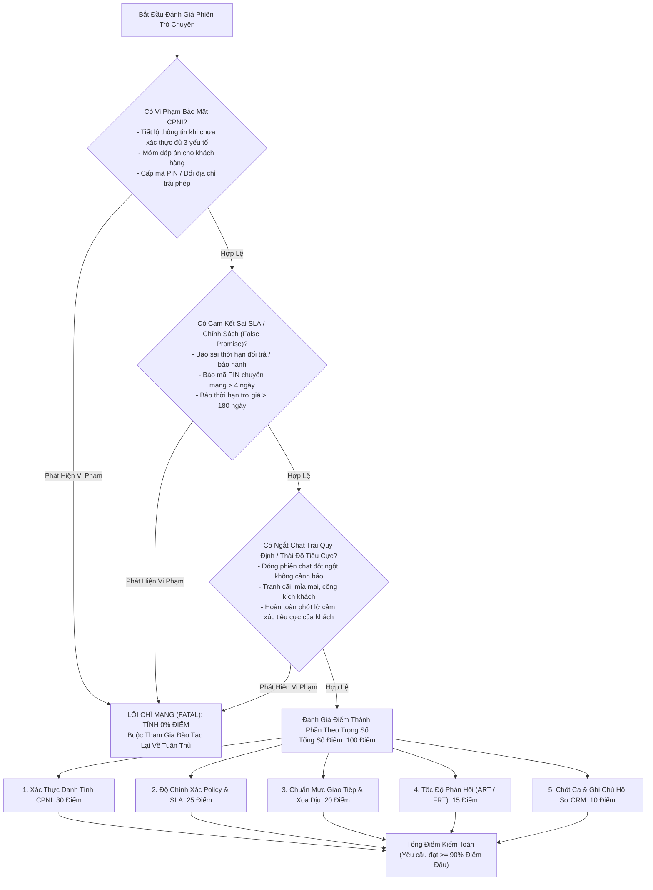
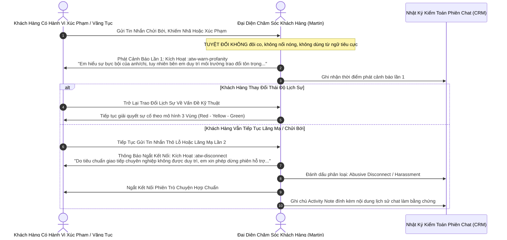

# CẨM NANG KIỂM TOÁN CHẤT LƯỢNG (QA) & THANG ĐIỂM TUÂN THỦ
**AirTalk Wireless & TAG Mobile - Tiêu Chuẩn Tương Tác Khách Hàng Đa Nền Tảng**
*Mã tài liệu: QA-AUD-MAN-2026-V3 | Phân loại: Tiêu chuẩn Tuân thủ Vận hành*
*Vị trí áp dụng: Đại diện Chăm sóc Khách hàng Bậc 1 (CSR: Martin)*

---

## 1. Khung Quản Trị Chất Lượng & Triết Lý Vận Hành

Chương trình Đảm bảo Chất lượng (QA) tại Softel Solutions thực thi các tiêu chuẩn nghiêm ngặt nhằm tuân thủ quy định của Ủy ban Truyền thông Liên bang (FCC), Cơ quan Dịch vụ Phổ cập Viễn thông (USAC) và các cam kết thời gian xử lý (SLA) nội bộ.

Trong môi trường trực tuyến đa nhiệm với lưu lượng cao (đồng thời xử lý từ 3 đến 5 phiên chat), mục tiêu tối thượng là **Triệt Tiêu 100% Lỗi Chí Mạng (Zero Fatal Compliance Violations)**. Chỉ cần vi phạm một lỗi chí mạng duy nhất, phiên tương tác sẽ bị **tính 0% điểm kiểm toán (Trượt kiểm toán tức thì)**, đồng thời nhân sự phải tham gia đào tạo lại bắt buộc.

### 1.1 Bốn Nguyên Tắc Vận Hành Nền Tảng
1. **Tuân Thủ Pháp Lý Tuyệt Đối:** Đóng gói sẵn các quy định luật định và con số chính sách chính xác vào các macro gõ tắt mở rộng để loại bỏ hoàn toàn nguy cơ sai sót do trí nhớ con người.
2. **Giải Phóng Bán Cầu Não:** Chuyển thao tác gõ tay lặp lại và việc tra cứu chính sách sang hệ thống phím tắt lắp ghép động thông minh.
3. **Thấu Cảm Bắt Buộc (Vùng Đỏ):** Luôn xoa dịu cảm xúc thất vọng của khách hàng bằng thông điệp Vùng Đỏ chân thành trước khi đưa ra bất kỳ giới hạn chính sách hoặc giải pháp kỹ thuật nào.
4. **Chuẩn Hóa Biến Số Động:** Tự động hóa việc điền các tham số động (`ticket_id`, `port_out_pin`, `puk`) qua biểu mẫu giao diện, triệt tiêu lỗi bỏ quên dấu ngoặc vuông khi gửi khách hàng.

---

## 2. Thang Điểm Kiểm Toán QA 100 Điểm Toàn Diện



---

## 3. Chi Tiết Các Tiêu Chí Đánh Giá & Quy Định Xử Lý Vi Phạm

### 3.1 Tiêu Chí 1: Xác Thực Danh Tính CPNI (Trọng số: 30% | Lỗi Chí Mạng)
- **Cơ sở pháp lý:** 47 U.S.C. § 222; FCC 47 CFR Part 64, Subpart U.
- **Yêu cầu kiểm toán:**
  - CSR bắt buộc phải thu thập đủ 3 thông tin định danh (Họ tên đầy đủ, Ngày tháng năm sinh DOB, 4 số cuối SSN) trước khi cung cấp bất kỳ dữ liệu cá nhân nào của tài khoản.
  - Phải đối soát khớp 100% với dữ liệu CRM trước khi xác nhận sự tồn tại của số máy, số dư, đơn hàng hay mã vận đơn.
  - Thu thập thông tin liên hệ phụ (Số điện thoại liên lạc lại và địa chỉ Email).
- **Hành vi phạm lỗi chí mạng (0% điểm ngay lập tức):**
  - Tiết lộ bất kỳ thông tin nào của tài khoản cho người chưa vượt qua xác thực.
  - "Mớm" hoặc gợi ý thông tin đúng khi khách đoán sai (ví dụ: *"Có phải tên anh bắt đầu bằng chữ H không?"*).
  - Tự ý cấp mã Port-Out PIN hoặc thực hiện đổi địa chỉ giao hàng khi chưa pass CPNI.
  - Tải ảnh giấy tờ tùy thân của khách dán trực tiếp vào Activity Note trên CRM.
- **Phím tắt phòng thủ:** `:atw-cpni-ask`, `:atw-cpni-pass`, `:atw-cpni-fail`.

### 3.2 Tiêu Chí 2: Độ Chính Xác Về Chính Sách & SLA (Trọng số: 25% | Lỗi Chí Mạng)
- **Cơ sở pháp lý:** Nguyên tắc Minh bạch Thông tin Cước của FCC (Truth-in-Billing).
- **Yêu cầu kiểm toán:**
  - Mọi mốc thời gian, điều kiện bảo hành và quyền lợi hoàn tiền phải phản ánh chính xác 100% tài liệu SOP đã ban hành.
- **Hành vi phạm lỗi chí mạng (0% điểm ngay lập tức - False Promise):**
  - Báo khách mua máy trả phí chỉ có 15 ngày đổi trả (chuẩn là 30 ngày thường).
  - Hứa hoàn tiền cước thuê bao tháng, dung lượng data đã sử dụng hoặc gói cước quốc tế ILD đã kích hoạt.
  - Bỏ sót mốc 48 giờ đối với các khiếu nại nứt vỡ màn hình hoặc hư hỏng ngoại quan.
  - Báo mã PIN chuyển mạng có hạn 30 ngày (chuẩn là đúng 4 ngày thường).
  - Báo thời hạn cam kết trợ giá thiết bị là 365 ngày (chuẩn là đúng 180 ngày hoạt động liên tục).
  - Tự ý hứa xuất kho giao hàng ngay trong ngày khi chưa có sự xác nhận của Trưởng nhóm Logistics.
- **Phím tắt phòng thủ:** `:atw-refund-ylw`, `:atw-war-ylw`, `:atw-po-ylw`, `:atw-nonuse-ylw`.

### 3.3 Tiêu Chí 3: Chuẩn Mực Giao Tiếp & Xoa Dịu Căng Thẳng (Trọng số: 20% | Lỗi Chí Mạng)
- **Yêu cầu kiểm toán:**
  - Bắt buộc phải có câu đồng cảm, xoa dịu cảm xúc trong tin nhắn phản hồi đầu tiên ngay khi khách thể hiện sự bức xúc.
  - Tuyệt đối giữ thái độ hòa nhã, lịch sự; không dùng từ ngữ công kích hoặc đôi co với khách.
- **Hành vi phạm lỗi chí mạng (0% điểm ngay lập tức):**
  - Đóng phiên chat đột ngột khi khách đang nói mà chưa thực hiện đúng quy trình cảnh báo 2 bước.
  - Có thái độ mỉa mai, đôi co, khiêu khích hoặc xúc phạm khách hàng.
  - Hoàn toàn phớt lờ sự cố gián đoạn sóng hoặc hư hỏng thiết bị mà khách đang gặp phải.
- **Phím tắt phòng thủ:** `:atw-deescalate`, `:atw-warn-profanity`, `:atw-disconnect`.

### 3.4 Tiêu Chí 4: Tốc Độ Phản Hồi (Trọng số: 15% | Trừ Điểm Thành Phần)
- **Mức hiệu năng chuẩn:**
  - **Thời gian phản hồi đầu tiên (FRT):** Chuẩn <= 20 giây; Quá 60 giây bị trừ điểm nặng.
  - **Thời gian phản hồi trung bình (ART):** Chuẩn <= 45 giây; Quá 90 giây bị tính lỗi tốc độ.
- **Mức khấu trừ điểm:**
  - Khoảng im lặng không có tin nhắn tương tác quá 90 giây: Trừ 10 điểm.
  - Không gửi tin nhắn giữ máy định kỳ khi đang tra cứu dữ liệu: Trừ 5 điểm.
- **Phím tắt phòng thủ:** Gõ `:atw-hold-check` hoặc `;h_check` mỗi 45 giây một lần để làm mới đồng hồ hệ thống.

### 3.5 Tiêu Chí 5: Chốt Ca & Ghi Chú Hồ Sơ CRM (Trọng số: 10% | Trừ Điểm Thành Phần)
- **Yêu cầu kiểm toán:**
  - Bắt buộc phải có câu hỏi xác nhận kết thúc chuẩn mực trước khi đóng phiên chat: *"Is there anything else I may assist you with today?"*
  - Phải cập nhật đầy đủ thông tin vào Activity Log trên CRM ngay khi kết thúc cuộc trò chuyện.
- **Mức khấu trừ điểm:**
  - Thiếu câu hỏi kết thúc chuẩn mực: Trừ 5 điểm.
  - Không ghi chú hoặc ghi chú sơ sài trên CRM: Trừ 5 điểm.
- **Phím tắt phòng thủ:** `:atw-wrapup`, `:atw-bye`, `:atw-crm-note`.

---

## 4. Quy Trình Cảnh Báo 2 Bước & Ngắt Kết Nối Hợp Chuẩn

CSR không có nghĩa vụ phải chấp nhận sự thô lỗ hoặc xúc phạm từ khách hàng. Tuy nhiên, để không bị trừ điểm lỗi đóng chat trái quy định, CSR Martin bắt buộc phải thực hiện tuần tự theo quy trình dưới đây:



---

## 5. Chiến Thuật Băng Chuyền 3 Giai Đoạn (Conveyor Belt)

Nhằm duy trì chỉ số ART luôn dưới 45 giây và triệt tiêu nguy cơ rò rỉ CPNI chéo khi trực từ 3 đến 5 cửa sổ chat cùng lúc, CSR áp dụng quy tắc vận hành băng chuyền:

```
+-----------------------------------------------------------------------------------------+
|                               QUY TRÌNH BĂNG CHUYỀN 3 GIAI ĐOẠN                         |
+-----------------------------------------------------------------------------------------+
| GIAI ĐOẠN 1: TIẾP NHẬN ĐẦU VÀO (Thời gian: 0 - 30 Giây)                                 |
| • Mục tiêu: Đạt chuẩn tốc độ phản hồi đầu tiên (FRT < 20s) và kích hoạt CPNI.          |
| • Thao tác:                                                                             |
|   1. Gõ ngay lời chào (:atw-hi).                                                        |
|   2. Gõ ngay câu hỏi xác thực (:atw-cpni-ask).                                          |
|   3. Toàn bộ thao tác chỉ mất <= 3 giây. Sau đó chuyển ngay sang cửa sổ chat tiếp theo. |
+-----------------------------------------------------------------------------------------+
                                            |
                                            v
+-----------------------------------------------------------------------------------------+
| GIAI ĐOẠN 2: TRA CỨU HỒ SƠ & GIỮ NHỊP HỘI THOẠI (Thời gian: 30 - 180 Giây)              |
| • Mục tiêu: Tra cứu CRM/OCS và ngăn khách hàng sốt ruột hoặc thoát phiên chat.          |
| • Thao tác:                                                                             |
|   1. Mở đúng tab CRM tương ứng với MDN / Enrollment ID của khách.                      |
|   2. Cứ mỗi 45 giây gõ phím tắt giữ máy (:atw-hold-check) để làm mới đồng hồ ART.       |
|   3. Đối soát kỹ lưỡng dữ liệu trả về trước khi soạn câu trả lời.                       |
+-----------------------------------------------------------------------------------------+
                                            |
                                            v
+-----------------------------------------------------------------------------------------+
| GIAI ĐOẠN 3: ĐƯA GIẢI PHÁP & KẾT THÚC CA (Thời gian: 180+ Giây)                         |
| • Mục tiêu: Ghép Lego [Yellow Policy] + [Green Solution], kiểm tra sự hài lòng và đóng. |
| • Thao tác:                                                                             |
|   1. Gõ phím tắt combo theo trường hợp (:atw-po-combo, :atw-rush-combo).                |
|   2. Gõ câu hỏi kết thúc chuẩn mực (:atw-wrapup).                                       |
|   3. Dán sẵn khung ghi chú hồ sơ CRM (:atw-crm-note) và hoàn tất phiên làm việc.       |
+-----------------------------------------------------------------------------------------+
```

---

## 6. Bảng Tra Cứu Phím Tắt Phòng Thủ Điểm Liệt QA

| Điểm Lỗ Hổng Kiểm Toán QA Thường Gặp | Rủi Ro Vận Hành Tiềm Ẩn | Phím Tắt Espanso Phòng Thủ Bắt Buộc | Kết Quả Đầu Ra Đạt Chuẩn Tuân Thủ |
| :--- | :--- | :--- | :--- |
| **Tiết Lộ Thông Tin Quá Sớm** | Báo cước, báo trạng thái khi chưa xác thực PII. | `:atw-cpni-ask`<br>`;v_cpni` | Đòi đủ Họ tên, Ngày sinh DOB và 4 số cuối SSN theo chuẩn luật định CPNI. |
| **Mớm Đáp Án Cho Khách Hàng** | Tiết lộ dữ liệu đúng khi khách trả lời sai. | `:atw-cpni-fail`<br>`;v_fail` | Báo sai lệch lịch sự; không tiết lộ dữ liệu hệ thống; hướng dẫn nộp giấy tờ tùy thân. |
| **Báo Sai Thời Hạn Bảo Hành** | Báo 15 ngày cào bằng hoặc quên mốc 48 giờ vỡ màn hình. | `:atw-war-ylw`<br>`;p_war` | Tách biệt rõ 15 ngày máy cũ và 30 ngày máy mới; nhấn mạnh mốc 48 giờ lỗi ngoại quan. |
| **Hứa Hoàn Tiền Sai Quy Định** | Hứa hoàn tiền đơn quá hạn 7 ngày hoặc hoàn tiền cước. | `:atw-refund-ylw`<br>`;p_ref` | Nêu rõ khung 15 ngày/30 ngày/7 ngày; tuyên bố cước viễn thông không thể hoàn tiền. |
| **Báo Sai Hạn Mã Transfer PIN** | Báo mã PIN có hạn 30 ngày; quên cảnh báo trợ giá. | `:atw-po-ylw`<br>`;p_po` | Nêu rõ mã PIN có hạn đúng 4 ngày; đưa ra cảnh báo cam kết trợ giá 180 ngày. |
| **Báo Sai Chu Kỳ Non-Usage** | Báo hủy số sau 30 ngày mà không nhắc mốc ân hạn. | `:atw-nonuse-ylw`<br>`;p_nonuse` | Trình bày chuẩn chu kỳ 30 ngày cảnh báo + 15 ngày ân hạn (tổng 45 ngày); báo NLAD trong 1 ngày. |
| **Bị Trừ Điểm Tốc Độ ART** | Để khách chờ quá 90 giây không có tin nhắn trấn an. | `:atw-hold-check`<br>`;h_check` | Phát tin nhắn giữ máy trấn an định kỳ mỗi 45 giây để làm mới đồng hồ thời gian. |
| **Ngắt Chat Trái Quy Định** | Đóng chat với khách thô lỗ mà chưa đưa ra cảnh báo. | `:atw-warn-profanity`<br>`;b_warn` | Phát thông điệp cảnh báo giữ gìn chuẩn mực giao tiếp chuyên nghiệp trước khi ngắt. |
| **Quên Ghi Chú Hồ Sơ CRM** | Để trống Activity Note sau khi kết thúc phiên chat. | `:atw-crm-note`<br>`;crm_note` | Chèn biểu mẫu chuẩn: Lý do liên hệ, Nguyên nhân gốc rễ, Giải pháp đã làm, Mã Ticket. |
