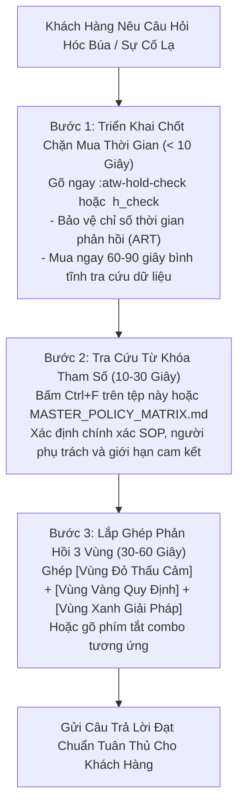

# TỪ ĐIỂN TRA CỨU NHANH & ĐỊNH VỊ TỪ KHÓA NGHIỆP VỤ (RAPID LOOKUP ENGINE)
**AirTalk Wireless & TAG Mobile - Phân Loại Chẩn Đoán & Đối Soát Nhanh Tình Huống**
*Mã tài liệu: OPS-REF-IDX-2026-V3 | Phân loại: Sổ tay Tra cứu Nhanh*
*Vị trí áp dụng: Đại diện Chăm sóc Khách hàng Bậc 1 (CSR: Martin)*

---

## 1. Quy Trình 3 Bước Xử Lý Tình Huống Lạ Giữa Biển Chính Sách

Khi gặp phải một câu hỏi hóc búa, sự cố hiếm gặp hoặc tình huống chính sách chưa từng tiếp xúc, CSR tuyệt đối không được tự ý phán đoán hoặc hứa hẹn bừa bãi. Hãy áp dụng quy trình định vị 3 bước chuẩn hóa:

---

## 2. Bảng Tra Cứu Từ Khóa Định Vị Nhanh (Ctrl + F Index)

Sử dụng tổ hợp phím `Ctrl + F` trên bàn phím để nhảy trực tiếp đến bất kỳ thuật ngữ, triệu chứng hoặc mã nghiệp vụ nào bên dưới:

| Từ Khóa Khách Nêu / Triệu Chứng Sự Cố | Lĩnh Vực Nghiệp Vụ | Quy Trình SOP Chi Phối | Thông Số Cốt Lõi Cần Nhớ | Phím Tắt Espanso Master | Phím Tắt Viết Tắt (Unikey) |
| :--- | :--- | :--- | :--- | :--- | :--- |
| **Xác thực danh tính / CPNI** | An Ninh CPNI | Account Verification V1.2 | Họ tên, DOB, SSN4 bắt buộc khớp 100%. | `:atw-cpni-ask` | `;v_cpni` |
| **Đoán sai thông tin / Pass CPNI thất bại** | An Ninh CPNI | Account Verification V1.2 | Dừng hỗ trợ cụ thể; hướng dẫn nộp ID. | `:atw-cpni-fail` | `;v_fail` |
| **Chuyển mạng / Lấy Transfer PIN** | Chuyển Mạng (LNP) | Port-Out SOP V2.1 | PIN hạn **4 ngày**; cảnh báo **180d trợ giá**. | `:atw-po-combo` | `;c_po` |
| **Hủy chuyển mạng / Ở lại với nhà mạng** | Giữ Chân Khách Hàng | Cancel Port-Out SOP | Hủy mã PIN 4 ngày; bảo lưu quyền lợi Lifeline. | `:atw-po-cancel` | `;g_po_cancel` |
| **Báo đã giao nhưng không thấy máy (DCNR)**| Khiếu Nại Logistics | DCNR V3.1 | Soát GPS/ảnh; tạo vé NUC; SLA **24-48h**. | `:atw-dcnr-combo` | `;c_dcnr` |
| **Vận đơn đứng yên quá 7 ngày (LIT)** | Khiếu Nại Logistics | Lost In Transit V2.1 | Phân loại dưới $100 vs trên $100; SLA **24-48h**. | `:atw-lit-combo` | `;c_lit` |
| **Bưu kiện bị gửi trả về kho (RTS)** | Khiếu Nại Logistics | Return To Sender V1.1 | Yêu cầu nộp xác minh địa chỉ trong **10 ngày**. | `:atw-rts-combo` | `;c_rts` |
| **Hối xuất kho gấp / Đơn khiếu nại FCC** | Xuất Hàng Khẩn Cấp | Hot Rush SOP | Xuất kho trong **24-48h** (Cuong Nguyen); cấm PAT. | `:atw-rush-combo` | `;g_hotrush` |
| **Điện thoại đặt mua bị hết hàng (OOS)** | Quản Lý Kho Bãi | Out of Stock SOP | Đổi sang mẫu máy tương đương hoặc gửi link chọn. | `:atw-oos-combo` | `;c_oos` |
| **Bảo hành điện thoại miễn phí (Free Phone)**| Đổi Trả Phần Cứng | Warranty V1.2 | Thời hạn bảo hành là **15 ngày thường**. | `:atw-war-ylw` | `;p_war` |
| **Bảo hành điện thoại mua mới / Upgrade** | Đổi Trả Phần Cứng | Warranty V1.2 | Thời hạn bảo hành là **30 ngày thường**. | `:atw-war-ylw` | `;p_war` |
| **Nứt vỡ màn hình / Hư hỏng ngoại quan** | Đổi Trả Phần Cứng | Warranty V1.2 | Bắt buộc phải báo trong vòng **48 giờ**. | `:atw-war-ylw` | `;p_war` |
| **Nhãn gửi bưu điện đổi trả (RMA Label)** | Logistics Hàng Trả | Warranty V1.2 | Phải đóng dấu gửi bưu điện trong **7 ngày việc**. | `:atw-rma-label` | `;g_rma` |
| **Cam kết trợ giá thiết bị 180 ngày** | Hợp Đồng Trợ Giá | Subsidy Agreement | Khách phải duy trì active đủ **180 ngày**. | `:atw-po-ylw` | `;p_po` |
| **Quy tắc 365 ngày nhận máy miễn phí** | Luật Định Lifeline | BYOD Guideline | Mỗi hộ gia đình nhận 1 máy miễn phí / **365 ngày**. | `:atw-byod-ylw` | `;p_byod` |
| **Bị ngắt sóng do không dùng (Non-Usage)** | Tuân Thủ USAC | Non-Usage Guideline V1.1 | 30d dùng + 15d ân hạn = **45d**; báo NLAD **1d**. | `:atw-nonuse-ylw` | `;p_nonuse` |
| **Hoàn tiền điện thoại đã giao thành công**| Kế Toán Tài Chính | Refund SOP V3.1 | Máy cũ **15d**, Máy mới **30d**, Không lỗi **7d**. | `:atw-refund-combo` | `;c_refund` |
| **Đòi hoàn tiền cước tháng / Data / ILD** | Kế Toán Tài Chính | Refund SOP V3.1 | Cước viễn thông và data **tuyệt đối không hoàn**. | `:atw-ref-non` | `;p_ref_non` |
| **Tạm giữ thẻ ngân hàng (Stripe Hold)** | Cổng Thanh Toán | Refund SOP V3.1 | Tiền tạm giữ tự nhả sau **7-10 ngày làm việc**. | `:atw-stripe-hold` | `;p_stripe` |
| **Yêu cầu hủy hợp đồng / Hủy dịch vụ** | Giữ Chân Khách Hàng | Cancellation SOP V1.1 | Thuyết phục rủi ro mất trợ cấp -> Chuyển Tier 2. | `:atw-cancel-t1` | `;c_cancel` |
| **Mua lại thiết bị để gỡ khóa MDM Buy-Out**| Quản Lý Thiết Bị | Cancellation SOP V1.1 | Thanh toán phần trợ giá còn lại để mở khóa MDM. | `:atw-mdm-buyout` | `;p_mdm` |
| **Tài khoản bị khóa điều tra Spam** | An Ninh Chống Lừa Đảo | Spam Handling V2.2 | Chặn đổi số/mua SIM; đòi ảnh ID sát mặt/video. | `:atw-spam-evasion` | `;c_spam` |
| **Mất cắp điện thoại / Khóa Blacklist** | An Ninh Chống Lừa Đảo | Lost/Stolen SOP | Khóa dòng cước tức thì và chặn IMEI quốc gia. | `:atw-stolen-combo` | `;c_stolen` |
| **Bị đại lý ngoài đánh cắp trợ cấp (Slam)**| Tuân Thủ Luật Định | Fraud Guideline | Báo Hotline USAC (**1-800-234-9473**); gửi đơn Reverse. | `:atw-slam-combo` | `;c_slam` |
| **SIM bị khóa mã số PUK** | Kỹ Thuật Mạng | PUK Code SOP | Tra PUK1 trên OCS; **sai 10 lần hỏng chip SIM**. | `:atw-puk-combo` | `;c_puk` |
| **Cài đặt SIM điện tử eSIM qua mã QR** | Kỹ Thuật Mạng | eSIM Guideline | Bắt buộc có Wi-Fi; xóa profile cũ quét lại QR. | `:atw-esim-combo` | `;c_esim` |
| **Yêu cầu đổi số điện thoại khác (MDN)** | Dịch Vụ Thuê Bao | MDN Change SOP V1.2 | Phí đổi số chuẩn **$25.00**; cảnh báo số rác cũ. | `:atw-mdn-combo` | `;c_mdn` |
| **Gọi quốc tế (ILD Calling)** | Dịch Vụ Mạng | ILD Guideline | 80 nước gọi miễn phí; $10/tháng cho nước khác. | `:atw-ild-info` | `;g_ild` |
| **Chuyển vùng quốc tế (Roaming)** | Quy Định Nhà Mạng | Network Policy | Chỉ dùng trong nội địa Mỹ; cấm Roaming ngoài nước. | `:atw-roam-no` | `;p_roam` |
| **Cài đặt / Reset mật khẩu Voicemail** | Dịch Vụ Mạng | Voicemail SOP | Mật khẩu mặc định là 4 số cuối MDN; nhấn giữ 1. | `:atw-vm-combo` | `;g_voicemail` |
| **Trượt tái xác thực năm (Recertify Fail)**| Quản Lý Thuê Bao | Recertify SOP | Bấm tạo link nộp lại hồ sơ cá nhân hóa trên CRM. | `:atw-recert-combo` | `;c_recert` |
| **Lỗi xác thực danh tính NLAD TRIV Fail** | Thẩm Định Hồ Sơ | Application SOP | Chuyển Review Team duyệt giấy tờ ID/SSN thủ công. | `:atw-triv-fail` | `;g_triv` |

---

## 3. Bảng Ma Trận Các Mốc Tham Số Ràng Buộc Hệ Thống

| Mã Tham Số / Quy Trình | Mốc Thời Gian Vận Hành Bắt Buộc | Căn Cứ Pháp Lý & Hợp Đồng | Mức Độ Nghiêm Trọng Khi Vi Phạm |
| :--- | :--- | :--- | :--- |
| **Bảo Hành Máy Miễn Phí** | **15 Ngày Thường** kể từ ngày giao | Chính Sách Đổi Trả Thiết Bị | Nghiêm Trọng (Mất quyền bảo hành của khách) |
| **Bảo Hành Máy Mua Mới** | **30 Ngày Thường** kể từ ngày giao | Chính Sách Đổi Trả Thiết Bị | Lỗi Chí Mạng QA (False Promise) |
| **Thời Hạn Báo Màn Hình Vỡ** | **Nghiêm Ngặt 48 Giờ** từ ngày giao | Quy Định Hư Hỏng Vận Chuyển | Cao (Công ty chịu chi phí rơi vỡ) |
| **Hạn Nhãn Bưu Điện RMA** | **7 Ngày Làm Việc** để đóng dấu gửi | Quy Chuẩn Logistics Hàng Trả | Trung Bình (Kho từ chối nhập hàng đổi) |
| **Cam Kết Trợ Giá Thiết Bị** | **180 Ngày Hoạt Động Liên Tục** | Hợp Đồng Trợ Giá Thuê Bao | Lỗi Chí Mạng QA (Sai lệch hợp đồng) |
| **Hạn Nhận Máy Miễn Phí** | **365 Ngày Thường** mỗi hộ gia đình | Quy Định Liên Bang Lifeline | Cao (Từ chối đơn trùng quyền lợi) |
| **Hiệu Lực Mã Transfer PIN** | **Đúng 4 Ngày Thường (96 Giờ)** | SOP Chuyển Mạng Port-Out V2.1 | Lỗi Chí Mạng QA (Hỏng lệnh chuyển mạng) |
| **Cảnh Báo Non-Usage** | **30 Ngày Liên Tục** không phát sinh cước| FCC 47 CFR § 54.405(e)(3) | Yêu Cầu Tuân Thủ Luật Định Bắt Buộc |
| **Thời Gian Ân Hạn Non-Usage**| **15 Ngày Thường** (Từ ngày 31 đến 45) | FCC 47 CFR § 54.405(e)(3) | Yêu Cầu Tuân Thủ Luật Định Bắt Buộc |
| **Đồng Bộ Dữ Liệu Lên NLAD** | **Trong 1 Ngày Làm Việc** sau ngày 46 | FCC 47 CFR § 54.407(c)(2) | Vi Phạm Pháp Lý Cấp Độ Liên Bang |
| **Tra Soát Vận Chuyển (SLA)** | **24 Đến 48 Giờ Làm Việc** | SOP Logistics DCNR / LIT | Chuẩn Mực Dịch Vụ Vận Hành |
| **Nhả Tiền Tạm Giữ Stripe** | **7 Đến 10 Ngày Làm Việc** | Chuẩn Mực Ngân Hàng Thanh Toán | Thấp (Leo thang khiếu nại ngân hàng) |
| **Kế Toán Hoàn Tiền Về Thẻ** | **3 Đến 5 Ngày Làm Việc** | Quy Trình Kế Toán Tài Chính | Trung Bình (Khiếu nại tranh chấp thẻ) |

---

## 4. Từ Điển Chuyển Ngữ Chính Sách Sang Lời Thoại Thấu Cảm

Khi giải thích các điều khoản pháp lý và giới hạn hệ thống cho khách hàng Mỹ đang bức xúc, CSR Martin tuyệt đối không trích dẫn luật một cách khô khan. Hãy chuyển ngữ các điều khoản kỹ thuật sang cấu trúc 3 Vùng (Red - Yellow - Green) chuẩn mực:

### 4.1 Khách Đòi Hoàn Tiền Khi Đã Quá Thời Hạn Quy Định
- **Cách nói sai (Dễ gây chửi bới):** *"You are past 7 days so you are not eligible for any refund under our rules."*
- **Cách nói chuẩn 3 Vùng (Chuyên nghiệp & Xoa dịu):**
  - `[VÙNG ĐỎ Thấu Cảm]:` *"I completely understand you would like to return the device and receive a refund."*
  - `[VÙNG VÀNG Chính Sách]:` *"Under our standard equipment policy, return requests for pre-owned equipment must be submitted within 15 calendar days of delivery, and the evaluation window for this purchase has concluded."*
  - `[VÙNG XANH Giải Pháp]:` *"While a direct refund cannot be processed, I can gladly assist you with technical troubleshooting to ensure the handset functions properly, or review our current discounted upgrade options."*

### 4.2 Giới Hạn Kênh Nhận Mã PIN Chuyển Mạng
- **Cách nói sai (Dễ gây bức xúc):** *"I cannot give you the PIN over chat or send to both SMS and email because the system will break."*
- **Cách nói chuẩn 3 Vùng (Chuyên nghiệp & Xoa dịu):**
  - `[VÙNG ĐỎ Thấu Cảm]:` *"I will be more than happy to help you securely retrieve your transfer credentials right away."*
  - `[VÙNG VÀNG Chính Sách]:` *"To protect your private account security and prevent duplicate code generation, our provisioning engine delivers the Transfer PIN through one verified channel at a time."*
  - `[VÙNG XANH Giải Pháp]:` *"Would you prefer to receive your 4-day Transfer PIN via text message to your active handset upon ICCID verification, or sent directly to your registered email address on file?"*

### 4.3 Thông Báo Thu Hồi Số Do Quá Hạn 45 Ngày Không Dùng (Non-Usage)
- **Cách nói sai (Dễ gây leo thang khiếu nại):** *"Your phone was cut off because you didn't use it for 45 days."*
- **Cách nói chuẩn 3 Vùng (Chuyên nghiệp & Xoa dịu):**
  - `[VÙNG ĐỎ Thấu Cảm]:` *"I sincerely apologize for the unexpected interruption to your wireless service."*
  - `[VÙNG VÀNG Chính Sách]:` *"Under federal Lifeline guidelines, free government-supported lines require active usage at least once every 30 days, followed by a 15-day grace period, before the national registry automatically de-enrolls the account."*
  - `[VÙNG XANH Giải Pháp]:` *"I can immediately provide you with a personalized re-enrollment link so you can re-establish your free monthly benefit and reconnect your service as quickly as possible."*
