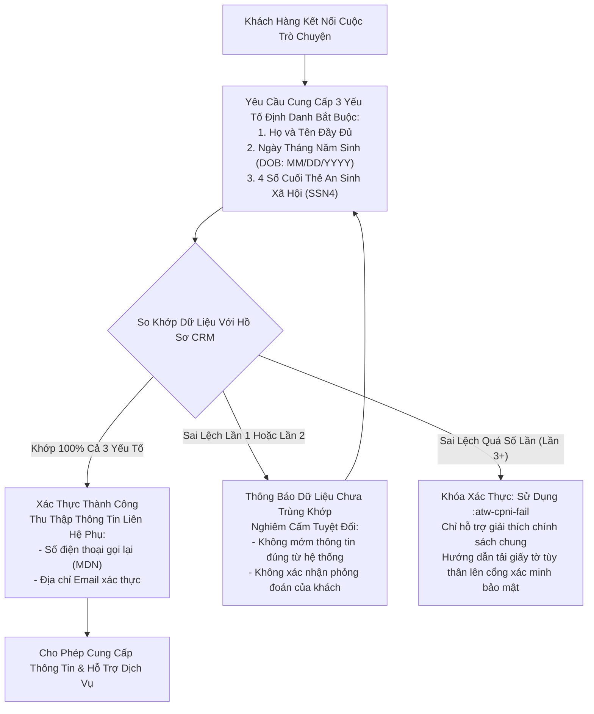
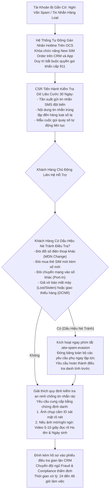
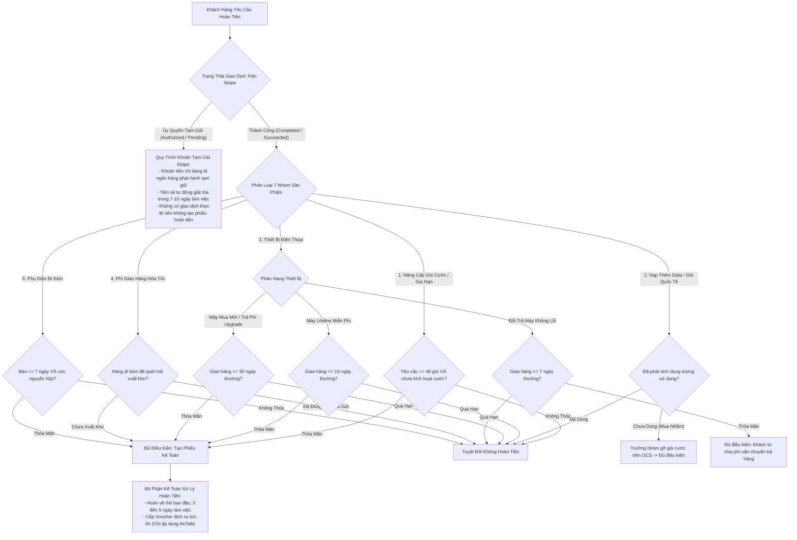
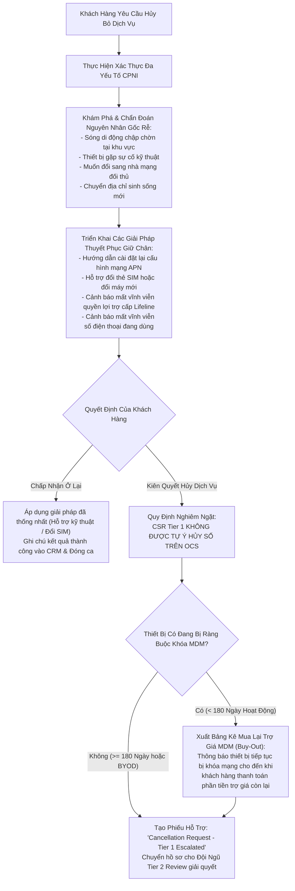
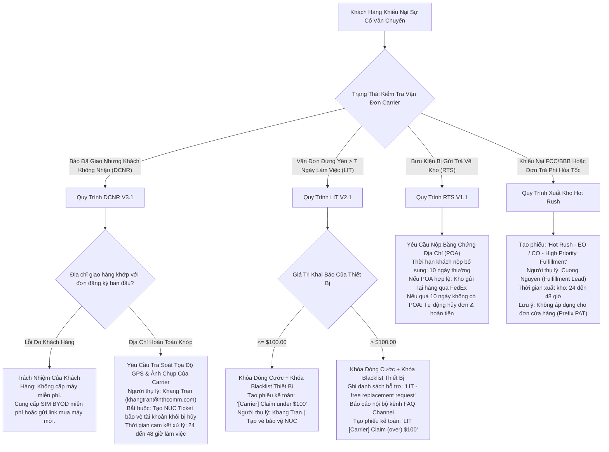
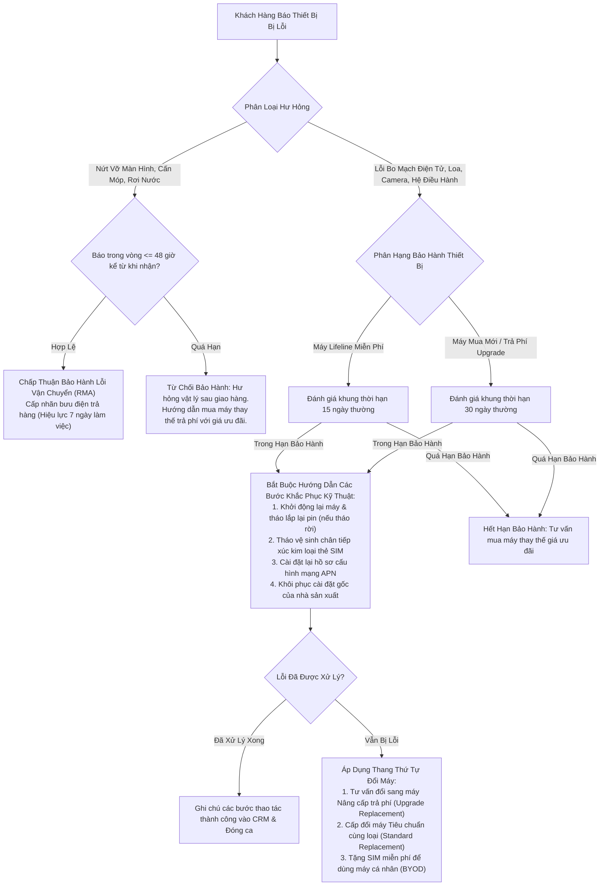
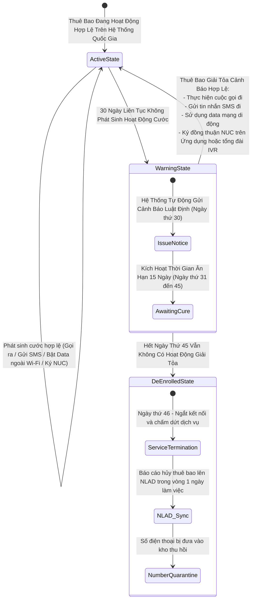
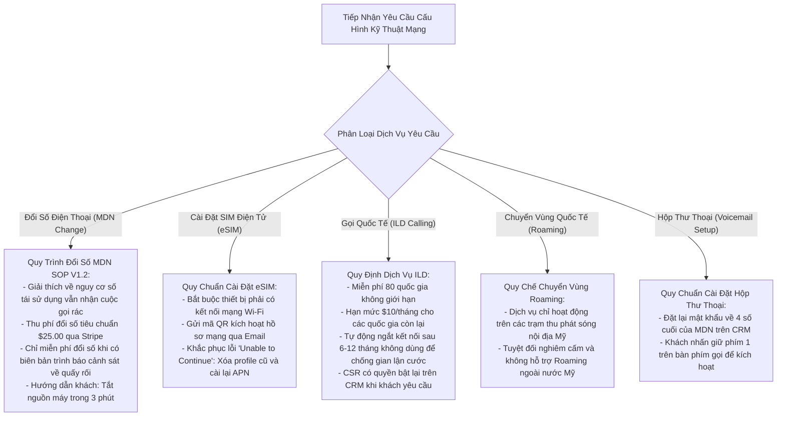

# ĐẶC TẢ KỸ THUẬT VẬN HÀNH & PHÂN TÍCH CHUYÊN SÂU SOP NỘI BỘ
**AirTalk Wireless & TAG Mobile - Hạ Tầng Viễn Thông Lifeline, ACP & MVNO**
*Mã tài liệu: SOP-INT-DIVE-2026-V3 | Phân loại: Tài liệu Kỹ thuật Vận hành Nội bộ*
*Vị trí áp dụng: Đại diện Chăm sóc Khách hàng Bậc 1 (CSR: Martin)*
*Căn cứ tài liệu: Đối chiếu chuyên sâu 57 văn bản Quy trình Vận hành Tiêu chuẩn (SOP), Quy chế Pháp lý & Nghiên cứu Tình huống Nội bộ*

---

## Tổng Quan Tài Liệu & Phạm Vi Pháp Lý

Tài liệu đặc tả kỹ thuật này cung cấp phân tích chi tiết, toàn diện về tất cả các phân hệ vận hành, khung tuân thủ pháp lý và quy trình xử lý nghiệp vụ nội bộ tại Softel Solutions. Mọi nội dung đều được kiểm toán đối chiếu trực tiếp từ các quy định của Ủy ban Truyền thông Liên bang (FCC), Cơ quan Dịch vụ Phổ cập Viễn thông (USAC), Cơ sở dữ liệu Trách nhiệm Giải trình Lifeline Quốc gia (NLAD) và các tiêu chuẩn bảo mật thanh toán thương mại điện tử.

---

## Mục Lục Chi Tiết
1. [Phân Hệ 1: Xác Thực Danh Tính CPNI, Bảo Vệ SIM Port-Protection & Chống Đánh Cắp Danh Tính](#phân-hệ-1)
2. [Phân Hệ 2: Điều Tra Gian Lận Spam & Kiến Trúc Chặn Hành Vi Né Tránh](#phân-hệ-2)
3. [Phân Hệ 3: Quản Lý Chuyển Mạng Port-Out & Vòng Đời Cấp Mã Nhà Mạng](#phân-hệ-3)
4. [Phân Hệ 4: Kiến Trúc Hoàn Tiền 7 Dòng Sản Phẩm & Xử Lý Giao Dịch Stripe](#phân-hệ-4)
5. [Phân Hệ 5: Quy Trình Hủy Dịch Vụ, Giữ Chân Khách Hàng Tier 1 & Mua Lại Trợ Giá MDM](#phân-hệ-5)
6. [Phân Hệ 6: Xử Lý Khiếu Nại Logistics, Bồi Thường Vận Chuyển & Xuất Hàng Hỏa Tốc](#phân-hệ-6)
7. [Phân Hệ 7: Quy Chuẩn Đổi Trả Bảo Hành (RMA), Giới Hạn BYOD 365 Ngày & Mã PUK](#phân-hệ-7)
8. [Phân Hệ 8: Tuân Thủ Luật Định Lifeline: Chu Kỳ Non-Usage 45 Ngày & Tái Xác Thực Hàng Năm](#phân-hệ-8)
9. [Phân Hệ 9: Thẩm Định Hồ Sơ Ứng Tuyển, Xử Lý Lỗi NLAD TRIV & Điều Chỉnh Đơn Hàng](#phân-hệ-9)
10. [Phân Hệ 10: Cấu Hình Kỹ Thuật Mạng, Đổi Số MDN, eSIM, Hộp Thư Thoại & ILD/Roaming](#phân-hệ-10)

---

<a name="phân-hệ-1"></a>
## 1. Phân Hệ 1: Xác Thực Danh Tính CPNI, Bảo Vệ SIM Port-Protection & Chống Đánh Cắp Danh Tính

### 1.1 Căn Cứ Văn Bản Pháp Lý & Quy Trình
- `Policy_Account Verification_AirTalk & TAG_V1.1.pdf` (Hiệu lực ngày 03/10/2026)
- `SOP_Account Verification Handling_AirTalk & TAG_V1.2.pdf`
- `Identity Theft.pdf` (Phiên bản 1 - Nhật ký cập nhật tháng 05/2025)
- `SIM Port Protection - CSR only.pdf`
- Căn cứ luật định: 47 U.S.C. § 222; FCC 47 CFR §§ 64.2001–64.2011 (Bảo vệ CPNI).

### 1.2 Kiến Trúc Xác Thực Đa Yếu Tố Bậc 1
Trước khi cung cấp bất kỳ thông tin nào về số máy, số dư tài khoản, mã đơn hàng, lịch sử vận chuyển hoặc thực hiện thay đổi kỹ thuật trên đường truyền, CSR bắt buộc phải xác thực danh tính khách hàng qua 3 yếu tố định danh bắt buộc:



#### Quy Chuẩn So Khớp Dữ Liệu Chi Tiết:
- **Họ và Tên Đầy Đủ:** First Name và Last Name bắt buộc phải khớp chính xác với hồ sơ CRM. Không bắt buộc Middle Name. Bỏ qua các hậu tố (*Jr., Sr., II, III, IV*) nếu Họ và Tên chính đã khớp. Chấp nhận các biến thể có dấu gạch nối (*Smith-Jones*) hoặc dấu nháy đơn (*O'Connor*).
- **Ngày Tháng Năm Sinh (DOB):** Bắt buộc phải khớp 100% theo định dạng chuẩn `MM/DD/YYYY` của Hoa Kỳ.
- **4 Số Cuối SSN:** Bắt buộc phải khớp chính xác với 4 số cuối đã lưu trên hệ thống đồng bộ từ USAC/NLAD.

### 1.3 Cơ Chế Khóa Tự Động SIM Port-Protection
- **Điều Kiện Kích Hoạt Tự Động:** Nếu khách hàng hoặc nhân viên nhập sai mã xác thực đổi SIM hoặc mã xác thực cấp Transfer PIN quá **3 lần liên tiếp**, hệ thống OCS sẽ tự động kích hoạt tính năng `SIM Port-Protection` (Khóa tài khoản trên toàn hệ thống).
- **Dấu Hiệu Nhận Biết Trên CRM:** Tab Activity ghi nhận dòng sự kiện: `SIM - Port Protection turned on / Locks Account`.
- **Quy Trình Mở Khóa:** Nhân viên không được phép mở khóa thủ công. Khách hàng bắt buộc phải tự đăng nhập vào cổng thông tin người dùng (`Account > My SIM > SIM - Port Unlock`) để tự thao tác mở khóa bảo mật.

### 1.4 Quy Định Vệ Sinh Hồ Sơ Chống Đánh Cắp Danh Tính (Identity Theft)
- **Quy Tắc Cập Nhật Ngày 09/05/2025:**
  > [!CAUTION]
  > **TUYỆT ĐỐI NGHIÊM CẤM TẢI LÊN, DÁN HOẶC ĐÍNH KÈM ẢNH GIẤY TỜ TÙY THÂN CỦA KHÁCH VÀO ACTIVITY NOTE TRÊN CRM!**
  > CSR chỉ được ghi nhận mã **Ticket ID** hoặc **Chat ID** có chứa tài liệu định danh đã được mã hóa vào Activity Note để tuân thủ luật bảo mật dữ liệu liên bang.

---

<a name="phân-hệ-2"></a>
## 2. Phân Hệ 2: Điều Tra Gian Lận Spam & Kiến Trúc Chặn Hành Vi Né Tránh

### 2.1 Căn Cứ Văn Bản Pháp Lý & Quy Trình
- `SOP_Spam Handling_AirTalk & TAG_V2.2_Active_2026-10-26.docx` (Hiệu lực ngày 26/10/2026 - 1.130 Đoạn văn)
- `SMS Spamming.pdf`, `SOP Spamming.drawio`

### 2.2 Sơ Đồ Quy Trình Điều Tra & Phòng Thủ Chống Né Tránh



### 2.3 Các Biện Pháp Chống Né Tránh Luật Định
Những đối tượng sử dụng dịch vụ vào mục đích lừa đảo hoặc gửi tin nhắn rác thường tìm cách né tránh khi bị phát hiện. Theo SOP V2.2, CSR bắt buộc tuân thủ:
1. **Phong Tỏa Tuyệt Đối Mọi Thay Đổi Dịch Vụ:** Trong thời gian tài khoản đang bị điều tra Spam, không một nhân viên nào được phép cấp SIM mới, đổi số điện thoại, phê duyệt đổi máy hoặc xử lý chuyển mạng vào.
2. **Quy Định Về Tính Năng Block Caller:** CSR tuyệt đối không được tự ý bật nút Block Caller trên hệ thống. Mọi yêu cầu chặn cuộc gọi phải được tạo phiếu hỗ trợ mức độ High chuyển lên kênh FAQ nội bộ cho Trưởng nhóm/Quản lý kỹ thuật phê duyệt.
3. **Quyền Tiếp Cận Cuộc Gọi Khẩn Cấp 911:** Quyền quay số 911 bắt buộc phải được đảm bảo hoạt động trong mọi tình huống.

---

<a name="phân-hệ-3"></a>
## 3. Phân Hệ 3: Quản Lý Chuyển Mạng Port-Out & Vòng Đời Cấp Mã Nhà Mạng

### 3.1 Căn Cứ Văn Bản Pháp Lý & Quy Trình
- `SOP_Port-Out_AirTalk & TAG_V2.1_Active_2026-10-19.docx` (506 Đoạn văn)
- `Porting Guideline.pdf`, `Cancel Port-Out - MVNO-C.png`, `PO-GEN-P001` đến `P005.png`
- Căn cứ luật định: Quy tắc Chuyển mạng Giữ số Không dây của FCC (47 CFR § 52.35).

### 3.2 Quy Trình Kiểm Tra Trạng Thái OCS & Phân Tuyến Nhà Mạng

```mermaid
sequenceDiagram
    autonumber
    actor CX as Khách Hàng
    actor CSR as Đại Diện Chăm Sóc Khách Hàng (Martin)
    participant OCS as Hệ Thống OCS / CRM
    participant Carrier as Nhà Mạng Tiếp Nhận Mới

    CX->>CSR: Yêu Cầu Cấp Số Tài Khoản & Mã Transfer PIN
    CSR->>OCS: Thực Hiện Xác Thực Đa Yếu Tố CPNI
    OCS-->>CSR: Xác Nhận Danh Tính Hợp Lệ
    CSR->>OCS: Tra Cứu Trạng Thái Đường Truyền OCS
    
    alt Trạng Thái KHÔNG Thuộc (Active, Hotlined, Barred, Expired)
        CSR->>CX: Từ Chối Cấp PIN: Số thuê bao không ở trạng thái hợp lệ để chuyển mạng
    else Trạng Thái Đủ Điều Kiện
        CSR->>CX: Cảnh Báo Cam Kết Trợ Giá 180 Ngày & Mất Quyền Lợi Trợ Cấp Hàng Tháng
        CSR->>CX: Yêu Cầu Chọn Kênh Nhận Duy Nhất (SMS có xác thực ICCID HOẶC Email)
        Note over CSR,OCS: Tuyệt đối chỉ gửi qua MỘT kênh duy nhất để tránh xung đột mã PIN
        CSR->>OCS: Thực Hiện Tạo Mã Transfer PIN (Hiệu lực đúng 4 ngày thường)
        OCS-->>CX: Mã PIN Được Gửi Thành Công Qua Kênh Đã Chọn
        CSR->>OCS: Tạo Phiếu Hỗ Trợ Cancellation Trên CRM
        
        alt Nhà Mạng Tiếp Nhận Là AT&T
            Note over OCS: Đường truyền tự động chấm dứt sau 48 giờ kể từ khi tạo phiếu
        else Nhà Mạng Tiếp Nhận Là MVNO-C
            Note over OCS: Khách có 15 ngày để chuyển; Bộ phận Retention xử lý hủy cuối tháng
        end
        
        Carrier->>OCS: Gửi Lệnh Yêu Cầu Chuyển Số Điện Tử
        OCS-->>Carrier: Phê Duyệt & Giải Phóng Số Thuê Bao Thành Công
    end
```

### 3.3 Các Quy Định Vận Hành Sống Còn
- **Thời Hạn Mã PIN Đúng 4 Ngày:** Mã Transfer PIN do hệ thống sinh ra có giá trị chính xác trong **4 ngày thường (96 giờ)**. Báo sai thành 30 ngày là lỗi Fatal QA.
- **Cảnh Báo Cam Kết Trợ Giá 180 Ngày:** Bắt buộc phải cảnh báo khách hàng rằng nếu chưa hoàn tất **180 ngày hoạt động liên tục**, việc chuyển mạng sẽ làm phát sinh phí phạt vi phạm cam kết trợ giá thiết bị.
- **Quy Định Số Tài Khoản:** Số tài khoản chuyển mạng chính là số điện thoại 10 chữ số (MDN) hoặc mã số Enrollment ID của khách.

---

<a name="phân-hệ-4"></a>
## 4. Phân Hệ 4: Kiến Trúc Hoàn Tiền 7 Dòng Sản Phẩm & Xử Lý Giao Dịch Stripe

### 4.1 Căn Cứ Văn Bản Pháp Lý & Quy Trình
- `SOP_Refund_AirTalk&TAG_V3.1_Active_2026-10-20.pdf` (84 trang)
- `Refund-case-studies.pdf` (19 slide tình huống thực tế)

### 4.2 Cây Quyết Định Thẩm Định Hoàn Tiền Cho 7 Nhóm Sản Phẩm



---

<a name="phân-hệ-5"></a>
## 5. Phân Hệ 5: Quy Trình Hủy Dịch Vụ, Giữ Chân Khách Hàng Tier 1 & Mua Lại Trợ Giá MDM

### 5.1 Căn Cứ Văn Bản Pháp Lý & Quy Trình
- `Policy_Cancellation_AirTalk & TAG_V1.1.pdf` (Hiệu lực ngày 28/08/2026)
- `SOP_Cancellation Handling - Tier 1_AirTalk & TAG_V1.1.pdf`
- `SOP_Cancellation Handling - Tier 2_AirTalk & TAG_V1.0.pdf`
- `Retention.pdf`

### 5.2 Sơ Đồ Quy Trình Phân Luồng Hủy Dịch Vụ & Mua Lại Trợ Giá MDM



---

<a name="phân-hệ-6"></a>
## 6. Phân Hệ 6: Xử Lý Khiếu Nại Logistics, Bồi Thường Vận Chuyển & Xuất Hàng Hỏa Tốc

### 6.1 Căn Cứ Văn Bản Pháp Lý & Quy Trình
- `Delivered Not Received (DCNR) V3.1.pdf` (52 trang)
- `Lost In Transit (LIT) V2.1.pdf` (11 trang)
- `Return to Sender (RTS) V1.1.pdf`
- `Hot Rush Ticket.pdf`

### 6.2 Ma Trận Tiếp Nhận & Định Tuyến Khiếu Nại Vận Chuyển



---

<a name="phân-hệ-7"></a>
## 7. Phân Hệ 7: Quy Chuẩn Đổi Trả Bảo Hành (RMA), Giới Hạn BYOD 365 Ngày & Mã PUK

### 7.1 Căn Cứ Văn Bản Pháp Lý & Quy Trình
- `ETC Handset_ Accessory Replacement Policy_During EBB_ACP_Final.pdf`
- `Warranty replacement V1.2.pdf` (33 trang)
- `REPLACEMENTS V1.1.pdf` (22 trang)
- `Bring Your Own Device.pdf` (Cập nhật ngày 27/03/2026)
- `PUK Code.pdf` (10 trang)

### 7.2 Cây Quyết Định Bảo Hành & Thang Đổi Máy Thay Thế



### 7.3 Các Quy Chuẩn Phần Cứng Sống Còn
1. **Quy Tắc 365 Ngày Nhận Máy Miễn Phí:** Khách hàng đã từng nhận điện thoại trợ cấp của chính phủ trong vòng **365 ngày gần nhất** sẽ không đủ điều kiện nhận thêm máy miễn phí. Hệ thống sẽ tự động chuyển đơn sang chế độ **BYOD (Chỉ cấp SIM)**.
2. **Quy Định An Toàn Thẻ SIM (Mã PUK):** Nhập sai mã PIN 3 lần -> Bị khóa PUK. Nhập sai mã PUK 10 lần liên tiếp -> **Cháy chip SIM vĩnh viễn**, bắt buộc phải đặt mua thẻ SIM mới.

---

<a name="phân-hệ-8"></a>
## 8. Phân Hệ 8: Tuân Thủ Luật Định Lifeline: Chu Kỳ Non-Usage 45 Ngày & Tái Xác Thực Hàng Năm

### 8.1 Căn Cứ Văn Bản Pháp Lý & Quy Trình
- `Non-usage Guideline - ver 1.1.pdf` (Cập nhật dự án SNU & đồng thuận qua IVR)
- `[AirTalk] Assistance Guideline for De-enroll CXs Due to Fail Recertify.pdf` (Cập nhật ngày 16/07)
- Căn cứ luật định: FCC 47 CFR § 54.405(e)(3); 47 CFR § 54.407(c)(2).

### 8.2 Biểu Đồ Trạng Thái Chu Kỳ 45 Ngày Giám Sát Cước



### 8.3 Xử Lý Thuê Bao Bị Hủy Do Trượt Tái Xác Thực (Recertify Fail)
Khi thuê bao bị cơ quan USAC báo hủy trợ cấp do không hoàn thành tái xác thực định kỳ:
1. AirTalk không ngắt đường truyền ngay lập tức; thuê bao được giữ ở trạng thái hoạt động tạm thời.
2. CSR bấm nút trên CRM để tạo **Đường dẫn Nộp lại Đơn (Re-apply Link) cá nhân hóa** gửi cho khách.
3. Nếu khách có nhu cầu giữ lại số điện thoại cũ: Bắt buộc tạo phiếu IT khẩn cấp để bảo lưu số trước khi đơn mới được phê duyệt.

---

<a name="phân-hệ-9"></a>
## 9. Phân Hệ 9: Thẩm Định Hồ Sơ Ứng Tuyển, Xử Lý Lỗi NLAD TRIV & Điều Chỉnh Đơn Hàng

### 9.1 Căn Cứ Văn Bản Pháp Lý & Quy Trình
- `Application Assistance Guideline.pdf`
- `Application-Assistance-Guideline-Case-Studies.pdf`
- `Customer Orders Change.pdf`

### 9.2 Các Tình Huống Thẩm Định Hồ Sơ Cốt Lõi
1. **Đơn Ứng Tuyển Quá 30 Ngày (Application > 30 Days):** Đơn nằm ở trạng thái chờ duyệt quá 30 ngày sẽ tự động hết hạn trên hệ thống quốc gia. CSR hướng dẫn khách làm lại đơn đăng ký mới.
2. **Lỗi Xác Thực Danh Tính Bên Thứ Ba (NLAD TRIV Fail):**
   - Xảy ra khi thông tin cá nhân của khách hàng không thể đối chiếu tự động với cơ sở dữ liệu định danh quốc gia.
   - CSR chuyển hồ sơ sang cho **Review Team** và hướng dẫn khách hàng tải lên bản chụp rõ nét giấy tờ tùy thân và bằng chứng số an sinh xã hội trên cổng xác minh.
3. **Điều Chỉnh Đơn Hàng Do Không Đủ Điều Kiện Vùng Bộ Tộc (Tribal):** Nếu khách hàng không thuộc vùng đất bộ tộc được công nhận, CSR chuyển đổi gói cước về gói Lifeline Tiêu chuẩn, chuyển hình thức giao hàng về Tiêu chuẩn và đổi mẫu máy sang dòng máy cơ bản (ví dụ dòng máy **A56**).

---

<a name="phân-hệ-10"></a>
## 10. Phân Hệ 10: Cấu Hình Kỹ Thuật Mạng, Đổi Số MDN, eSIM, Hộp Thư Thoại & ILD/Roaming

### 10.1 Sơ Đồ Quy Trình Cấu Hình Kỹ Thuật Dịch Vụ Mạng



---

## 11. Bảng Danh Bạ Phân Công Trách Nhiệm & Đầu Mối Liên Hệ Nội Bộ

| Lĩnh Vực Vận Hành | Quy Trình SOP Chi Phối | Thời Gian Cam Kết (SLA) | Đầu Mối Phụ Trách / Email | Kênh Báo Cáo Leo Thang |
| :--- | :--- | :--- | :--- | :--- |
| **Khiếu Nại Vận Chuyển DCNR / LIT**| DCNR V3.1 / LIT V2.1 | 24 đến 48 Giờ Làm Việc | Khang Tran (`khangtran@hthcomm.com`) | Trưởng Nhóm Logistics / Kênh FAQ |
| **Xuất Kho Hỏa Tốc Hot Rush** | Hot Rush Fulfillment SOP | 24 đến 48 Giờ xuất kho | Cuong Nguyen (Fulfillment Lead) | Văn Phòng Điều Hành Khiếu Nại FCC |
| **Tiếp Nhận Lỗi Ngoại Quan Màn Hình**| Handset Policy V1.2 | Nghiêm ngặt trong vòng 48 Giờ | CSR Bậc 1 (Martin) tiếp nhận | Đội Ngũ Logistics Hàng Trả |
| **Thời Hạn Gửi Nhãn Bưu Điện RMA** | Handset Policy V1.2 | 7 Ngày Làm Việc đóng dấu bưu điện | Đội Ngũ Kho Nhận Hàng Trả | Bộ Phận Kế Toán Kho |
| **Hiệu Lực Mã Transfer PIN** | Port-Out SOP V2.1 | Đúng 4 Ngày Thường (96 Giờ) | Hệ thống OCS tự động phát hành | Kỹ Thuật Mạng OCS |
| **Giải Tỏa Khoản Tạm Giữ Stripe** | Refund SOP V3.1 | 7 đến 10 Ngày Làm Việc | Ngân Hàng Phát Hành Thẻ Của Khách | Kế Toán Thanh Toán Thẻ |
| **Kế Toán Hoàn Tiền Về Thẻ** | Refund SOP V3.1 | 3 đến 5 Ngày Làm Việc | Bộ Phận Kế Toán Tài Chính | Trưởng Phòng Tài Chính |
| **Hủy Thuê Bao Do Non-Usage** | Non-Usage SOP V1.1 | Ngày 46 Hủy / 1 Ngày Báo NLAD | Hệ Thống Tự Động / Pháp Chế | Ban Giám Đốc Pháp Lý & Tuân Thủ |
| **Xét Duyệt Phiếu Hủy Dịch Vụ** | Cancellation V1.1 | 24 đến 48 Giờ Làm Việc | Đội Ngũ Đánh Giá Hủy Dịch Vụ Tier 2 | Trưởng Bộ Phận Chăm Sóc Khách Hàng |
